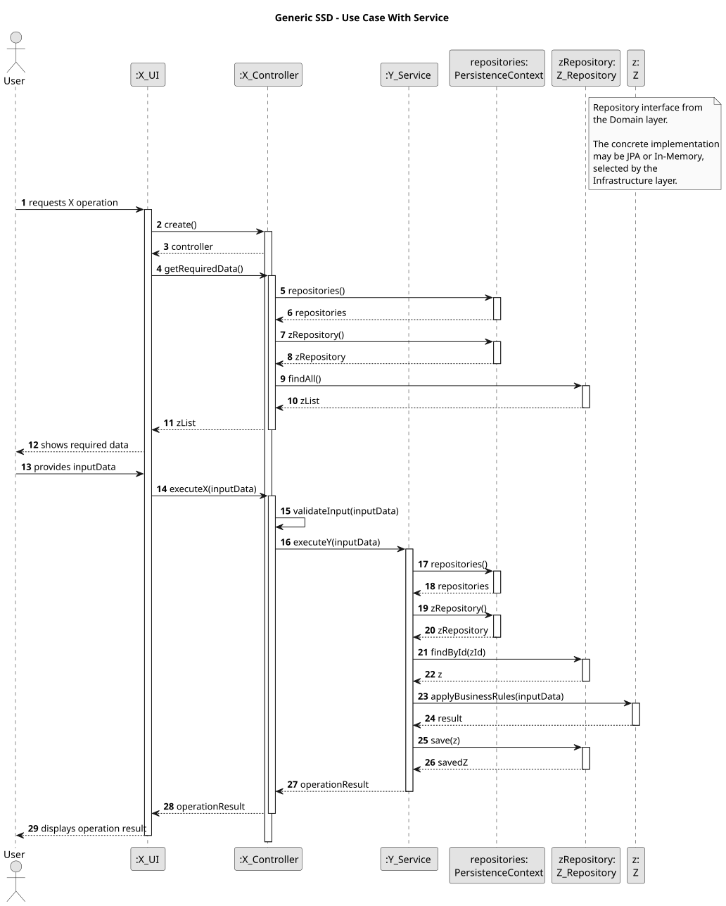
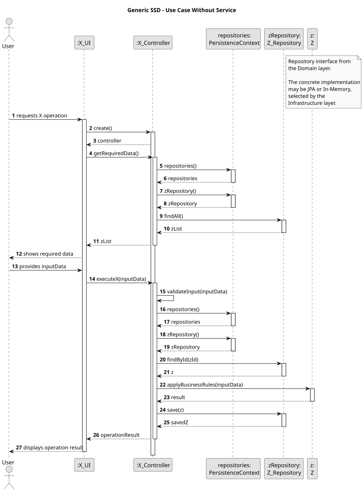

# 1. General Architecture

## 1.1 Architectural Style

The SEM4PI project follows a layered architecture inspired by the EAPLI framework and the reference eCafeteria project.

The system is organized into the following layers:

- Presentation Layer
- Application Layer
- Domain Layer
- Infrastructure Layer

Persistence is implemented inside the Infrastructure layer through repository implementations and persistence configuration.

This architecture separates responsibilities between user interaction, use case coordination, business logic and persistence mechanisms.

The architecture follows the principles of:

- High Cohesion
- Low Coupling
- Dependency Inversion
- Repository Pattern
- Factory Pattern
- Domain-Driven Design (DDD)

The system avoids direct coupling between the domain model and persistence or UI technologies.

---

# 1.2 Package Structure

```text
pt.isep.sem4pi
├── application
├── domain
├── infrastructure
└── presentation
````

Each package has a specific responsibility.

---

# 1.3 Presentation Layer

Package:

```text
pt.isep.sem4pi.presentation
```

Responsibilities:

* Present menus and UI flows
* Collect user input
* Show operation results
* Trigger use case execution through controllers

Main components:

* `SEM4PIBackoffice`
* `MainMenu`
* `authz`
* UI Actions

The presentation layer follows the EAPLI console framework structure.

Rules:

* The UI must not contain business rules.
* The UI must not access repositories directly.
* The UI delegates operations to controllers.
* The UI may validate input format, but business validation belongs to the domain layer.

Expected flows:

The following generic flows describe the expected interaction between the Presentation layer and the remaining application layers.

These flows use generic names such as `X_UI`, `X_Controller`, `Y_Service` and `Z_Repository`, which must be replaced by the concrete classes of each user story.



---
### Or without a service layer:


---

# 1.4 Application Layer

Package:

```text
pt.isep.sem4pi.application
```

Responsibilities:

* Coordinate use cases
* Execute application workflows
* Validate application-level preconditions
* Obtain repositories through `PersistenceContext`
* Coordinate domain objects and services

Main packages:

* `controller`
* `service`
* `Menu`

The application layer acts as the mediator between the UI and the domain model.

Rules:

* Controllers coordinate use cases.
* Controllers must not contain core business rules.
* Controllers may validate permissions and authentication.
* Controllers access persistence only through repository interfaces.
* Controllers must not depend directly on JPA or in-memory implementations.

Example flow:

```text
Controller -> Repository
Controller -> Domain Object
Controller -> Domain Service
```

---

# 1.5 Domain Layer

Package:

```text
pt.isep.sem4pi.domain
```

Responsibilities:

* Represent business concepts
* Enforce business rules
* Protect invariants
* Define aggregates, entities and value objects
* Define repository interfaces

Main packages:

* `model`
* `repositories`
* `usermanagement`

The domain layer follows Domain-Driven Design principles.

The domain model must remain independent from:

* UI technologies
* Persistence technologies
* Database implementation details

---

# 1.6 DDD Rules Used in the Project

## Aggregate Roots

Aggregate roots are the main entry points for modifying domain objects.

Examples:

* `User`
* `Manufacturer`
* `EngineModel`
* `AircraftModel`
* `Airport`
* `Flight`
* `FlightPlan`
* `Simulation`

Rules:

* Only aggregate roots should be directly obtained from repositories.
* Internal objects should be accessed through the aggregate root.
* Aggregates are responsible for maintaining consistency.
* One use case should preferably update only one aggregate.

---

## Entities

Entities represent domain objects with identity.

Rules:

* Entities must have business identity.
* Entities must not behave as simple data structures.
* Entities should expose intention-revealing operations.

Preferred:

```java
user.disable();
aircraftModel.addCertifiedEngineModel(engineModel);
```

Avoid:

```java
user.setStatus(...);
aircraftModel.setEngineModels(...);
```

The project follows the "Tell, Don’t Ask" principle.

---

## Value Objects

Value Objects represent concepts identified only by their values.

Examples:

* `Email`
* `PhoneNumber`
* `AircraftRegistration`
* `Coordinates`
* `IATACode`
* `ICAOCode`

Rules:

* Value Objects should be immutable whenever possible.
* Value Objects validate their own data.
* Primitive types should be avoided when representing domain concepts.

Preferred:

```java
private AircraftRegistration registration;
```

Avoid:

```java
private String registration;
```

---

# 1.7 Business Identifiers vs Database Identifiers

The project separates business identifiers from persistence identifiers.

Business identifiers belong to the domain model.

Database identifiers exist only for persistence support.

Examples:

| Concept      | Business Identifier   | Database Identifier  |
| ------------ | --------------------- | -------------------- |
| User         | Email / Username      | Internal database id |
| Airport      | IATA / ICAO code      | Internal database id |
| Aircraft     | Aircraft Registration | Internal database id |
| Engine Model | Model Name            | Internal database id |

Rules:

* Business identifiers must not be replaced by database ids.
* Database ids should not appear in the UI.
* Business identifiers should be represented explicitly through domain objects or value objects.

---

# 1.8 Repository Architecture

Repository interfaces are defined in:

```text
pt.isep.sem4pi.domain.repositories
```

Repository implementations are defined in:

```text
pt.isep.sem4pi.infrastructure.persistence
```

The system supports:

* In-memory repositories
* JPA repositories

Main components:

* `RepositoryFactory`
* `InMemoryRepositoryFactory`
* `PersistenceContext`

Rules:

* One repository should exist per aggregate root when persistence is required.
* Controllers depend on repository interfaces, not implementations.
* Persistence details must remain hidden from the rest of the system.
* Repository implementations are selected through configuration.

This follows the Repository and Abstract Factory patterns.

---

# 1.9 Persistence Strategy

The selected persistence implementation is configured through:

```text
application.properties
```

Supported persistence mechanisms:

* In-memory persistence
* Relational database persistence using JPA

Rules:

* The application layer must not know which persistence mechanism is active.
* Switching persistence implementation must not require changes in controllers or domain objects.
* Persistence logic belongs only to the infrastructure layer.

---

# 1.10 Infrastructure Layer

Package:

```text
pt.isep.sem4pi.infrastructure
```

Responsibilities:

* Configure persistence
* Provide repository implementations
* Initialize bootstrap data
* Integrate EAPLI framework components

Main packages:

* `bootstrap`
* `persistence`

Bootstrap classes:

* `BackofficeConfigurationBootstrapper`
* `MasterUsersBootstrapper`

Rules:

* Bootstrap initializes reference and demo data.
* Infrastructure depends on domain abstractions.
* Domain must not depend on infrastructure.

---

# 1.11 Framework Usage

The project uses EAPLI framework concepts and infrastructure.

Framework elements used:

* Console framework
* Authz framework
* Repository support
* AggregateRoot
* Entity
* ValueObject
* Preconditions
* Invariants

Rules:

* Preconditions validate operation arguments.
* Invariants protect aggregate consistency.
* Authentication and authorization use the Authz framework.
* Repository implementations use EAPLI persistence support when applicable.

---

# 1.12 Preconditions and Invariants

Preconditions are conditions that must be verified before executing an operation.

Examples:

* User must be authenticated
* User must have the required role
* Input data must not be null
* Aggregate root must exist

Example:

```java
Preconditions.nonNull(engineModel);
```

Invariants are rules that must always remain true inside the domain model.

Examples:

* An aircraft model must always contain at least one engine model
* Airport codes must be unique
* A disabled user cannot authenticate

Rules:

* Preconditions may be checked in controllers or constructors.
* Business invariants must be enforced inside domain objects.
* UI validation alone is not sufficient.

---

# 1.13 Business Rule Placement

Business rules are placed as close as possible to the domain concept that owns them.

Responsibilities:

| Layer          | Responsibility                    |
| -------------- | --------------------------------- |
| Presentation   | Input/output                      |
| Application    | Use case coordination             |
| Domain         | Business rules                    |
| Infrastructure | Technical support and persistence |

Examples:

* Authentication checks belong to the application/authz level.
* Aircraft consistency rules belong to the domain model.
* Persistence belongs to infrastructure.

---

# 1.14 Concurrency Control

The project supports optimistic concurrency control when using JPA persistence.

Rules:

* Aggregate roots may include a version field.
* Concurrent updates must be detected.
* Lost updates must be prevented.

Example:

```java
@Version
private Long version;
```

This prevents inconsistent updates when multiple users modify the same aggregate simultaneously.

---

# 1.15 Dependency Rules

Allowed dependencies:

```text
Presentation -> Application
Application -> Domain
Application -> Repository Interfaces
Infrastructure -> Domain
Infrastructure -> Application (bootstrap only)
Persistence Implementations -> Repository Interfaces
```

Forbidden dependencies:

```text
Domain -> Presentation
Domain -> Infrastructure
Presentation -> Database
Presentation -> JPA Repositories
```

The domain layer must remain persistence independent.

---

# 1.16 Development Process

Each user story should include:

1. Requirements analysis
2. Preconditions
3. SSD (generic and complete)
4. Design documentation
5. Class and sequence diagrams
6. Tests
7. Implementation notes

Rules:

* Tests should focus mainly on domain rules and controller behaviour.
* Documentation must remain aligned with the domain model.
* The architecture must remain consistent across all user stories.

---

# 1.17 Architectural Summary

The SEM4PI project follows a layered architecture combined with DDD principles and EAPLI framework practices.

The presentation layer handles interaction with the user, the application layer coordinates use cases, the domain layer contains business rules and the infrastructure layer handles persistence and technical support.

This architecture allows:

* Separation of responsibilities
* Persistence independence
* Reduced coupling
* Better maintainability
* Better alignment with the domain model
* Easier replacement of infrastructure components