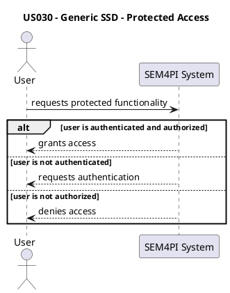
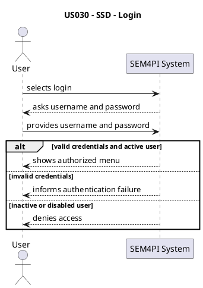
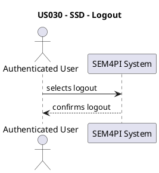
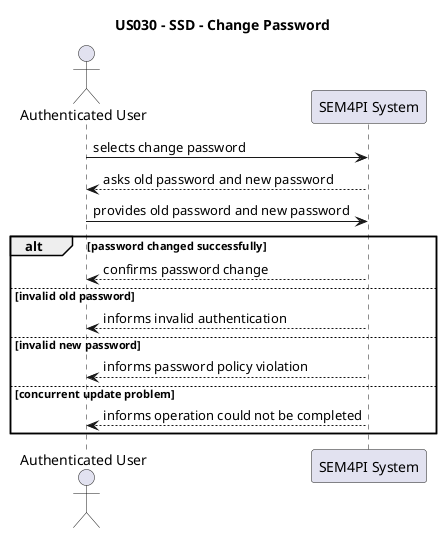
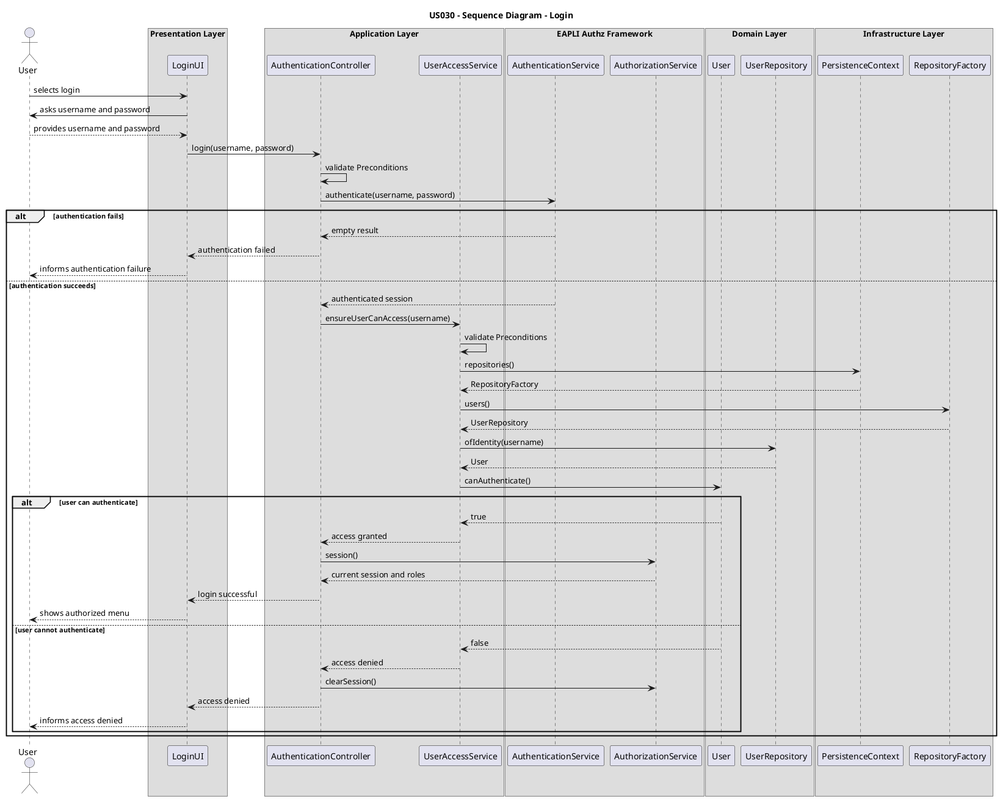
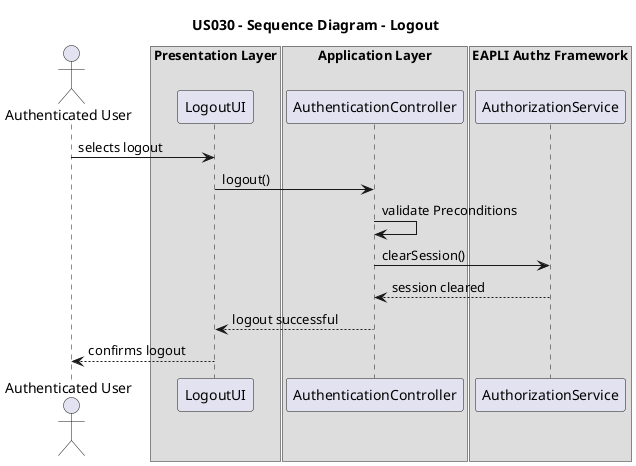
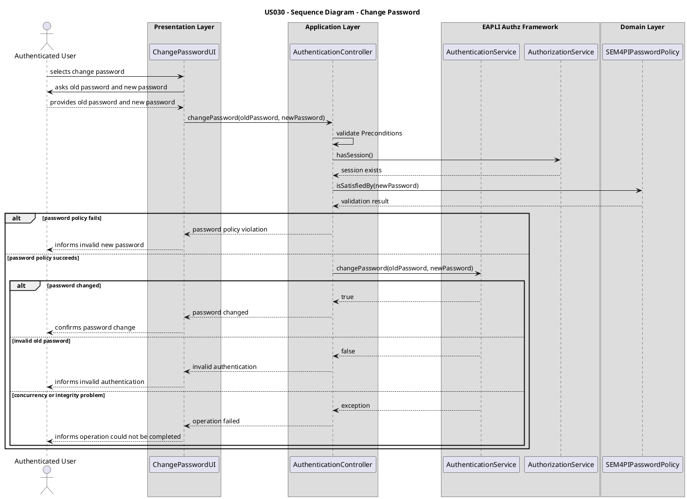
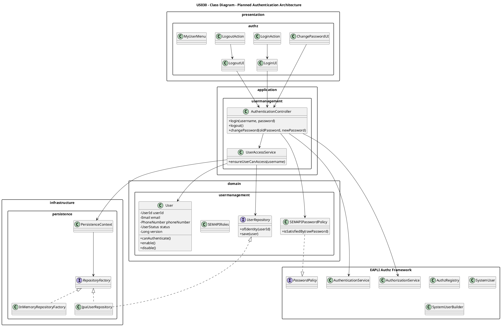

# US030 - Authentication and Authorization

## 1. Purpose

US030 defines how authentication and authorization will be planned and implemented in the SEM4PI backoffice.

This user story is transversal because all protected functionalities depend on authenticated and authorized users.

The solution will follow the project architecture:

```text
Presentation -> Application -> Domain
Infrastructure -> Domain abstractions
Persistence implementations -> Repository interfaces
````

The EAPLI framework will be used for authentication, authorization, repositories, console UI support, preconditions and invariants. The framework explicitly supports DDD, persistence, utilities, console presentation and Authz.

---

## 2. Architectural Decision

Authentication and authorization will not be implemented manually.

The system will use:

```text
EAPLI Authz Framework
```

Main framework elements:

```text
AuthzRegistry
AuthenticationService
AuthorizationService
SystemUser
SystemUserBuilder
PasswordPolicy
```

The project-specific domain model will still contain the domain `User` aggregate.

Therefore:

| Concept                    | Responsibility                                     |
| -------------------------- | -------------------------------------------------- |
| `SystemUser`               | Technical authentication user from EAPLI           |
| `User` aggregate           | Business user identity, status and access rules    |
| `SEM4PIPasswordPolicy`     | Project password policy                            |
| `SEM4PIRoles`              | Project roles                                      |
| `AuthenticationController` | Coordinates login/logout/change password use cases |
| `UserAccessService`        | Validates domain access rules                      |
| `UserRepository`           | Provides access to the domain `User` aggregate     |

This keeps framework authentication separated from business user rules.

---

## 3. Layered Architecture for US030

The EAPLI sample project separates Presentation, Application, Domain and Persistence layers. Presentation is the UI layer, Application contains services/controllers, Domain contains business objects and Persistence contains repositories.

### 3.1 Presentation Layer

Package:

```text
pt.isep.sem4pi.presentation.authz
```

Responsibilities:

```text
- Show login, logout and change password screens
- Collect user input
- Display operation results
- Trigger use case execution through controllers
```

Planned components:

```text
LoginUI
LoginAction
LogoutUI
LogoutAction
ChangePasswordUI
MyUserMenu
```

Rules:

```text
- UI must not contain business rules
- UI must not access repositories
- UI must not validate business preconditions
- UI delegates the operation to controllers
```

Valid UI responsibility:

```text
Read username
Read password
Show success/error message
```

Invalid UI responsibility:

```text
Check if user is disabled
Check if user has permission
Access UserRepository
Validate domain invariants
```

---

### 3.2 Application Layer

Package:

```text
pt.isep.sem4pi.application.usermanagement
```

Planned components:

```text
AuthenticationController
UserAccessService
```

Responsibilities:

```text
- Coordinate login
- Coordinate logout
- Coordinate change password
- Validate application-level preconditions
- Use EAPLI AuthenticationService and AuthorizationService
- Obtain repositories through PersistenceContext when domain user data is needed
```

Rules:

```text
- Controllers coordinate use cases
- Controllers validate preconditions using EAPLI Preconditions
- Controllers may check authentication and authorization
- Controllers do not contain core business rules
- Controllers access repositories through interfaces
```

Example planned flow:

```text
LoginUI -> AuthenticationController -> AuthenticationService
AuthenticationController -> UserAccessService -> UserRepository -> User aggregate
```

---

### 3.3 Domain Layer

Package:

```text
pt.isep.sem4pi.domain.usermanagement
```

Planned concepts:

```text
User
UserId
Email
PhoneNumber
UserStatus
Role
SEM4PIRoles
SEM4PIPasswordPolicy
UserRepository
```

Responsibilities:

```text
- Represent business user identity
- Represent user access status
- Protect user invariants
- Define project roles
- Define password policy
```

Rules:

```text
- User is an aggregate root
- UserRepository retrieves User aggregates
- Business rules belong to the User aggregate or domain services
- User must expose intention-revealing methods
```

Preferred:

```java
user.disable();
user.enable();
user.canAuthenticate();
```

Avoid:

```java
user.setEnabled(false);
```

The slides reinforce that entities should be valid, have identity, implement business rules and avoid being just data structures.

---

### 3.4 Infrastructure Layer

Package:

```text
pt.isep.sem4pi.infrastructure.persistence
```

Responsibilities:

```text
- Provide repository implementations
- Hide persistence details
- Provide RepositoryFactory
- Provide PersistenceContext
- Support in-memory and JPA persistence
```

Rules:

```text
- Infrastructure depends on domain abstractions
- Domain does not depend on infrastructure
- Controllers depend on repository interfaces
- Persistence implementation is selected through configuration
```

The EAPLI material explicitly separates repository definition from implementation and applies the Abstract Factory pattern to hide persistence details.

---

## 4. Preconditions

Preconditions must be validated outside the UI.

The EAPLI framework provides `Preconditions` to validate method parameters and `Invariants` to validate internal object consistency.

### 4.1 Login Preconditions

Validated in:

```text
AuthenticationController.login(...)
```

Preconditions:

```text
- username must not be null or empty
- password must not be null or empty
- AuthenticationService must be configured
```

Example:

```java
Preconditions.nonEmpty(username, "Username must not be empty");
Preconditions.nonEmpty(password, "Password must not be empty");
Preconditions.nonNull(authenticationService, "Authentication service must be configured");
```

---

### 4.2 Logout Preconditions

Validated in:

```text
AuthenticationController.logout()
```

Preconditions:

```text
- AuthorizationService must be configured
- there must be an active session
```

---

### 4.3 Change Password Preconditions

Validated in:

```text
AuthenticationController.changePassword(...)
```

Preconditions:

```text
- user must be authenticated
- old password must not be null or empty
- new password must not be null or empty
- new password must satisfy SEM4PIPasswordPolicy
```

---

### 4.4 Access Preconditions

Validated in:

```text
UserAccessService.ensureUserCanAccess(...)
```

Preconditions:

```text
- user identity must not be null
- User aggregate must exist
```

Business validation:

```text
- User must be active
- User must not be disabled
```

---

## 5. Business Rules

| ID          | Business Rule                                                     | Owner              |
| ----------- | ----------------------------------------------------------------- | ------------------ |
| BR-US030-01 | User must authenticate before accessing protected functionalities | Application/Authz  |
| BR-US030-02 | User must have the required role to access a functionality        | Application/Authz  |
| BR-US030-03 | Disabled users cannot authenticate into the system                | Domain User        |
| BR-US030-04 | Password must satisfy SEM4PIPasswordPolicy                        | Domain/Application |
| BR-US030-05 | Logout clears the active session                                  | Application/Authz  |
| BR-US030-06 | Change password requires an authenticated session                 | Application/Authz  |

Important:

```text
The rule "disabled users cannot authenticate" is not a UI rule.
It belongs to the User aggregate and is coordinated by UserAccessService.
```

---

## 6. Invariants

Domain invariants:

```text
- User must have a valid business identity
- User must have a valid email
- User must have at least one role
- User must have a status
- Disabled users cannot access protected functionalities
```

Framework-related invariants:

```text
- SystemUser must respect the configured PasswordPolicy
- AuthzRegistry must be configured before authentication is used
```

---

## 7. Concurrency Strategy

US030 can update user authentication data when changing passwords.

When JPA persistence is used, aggregate roots must support optimistic locking.

Planned domain entity field:

```java
@Version
private Long version;
```

The EAPLI sample project explains concurrent access with optimistic locking, where one user saves successfully and the second update fails because the record was already changed.

Strategy:

```text
- Use optimistic locking for persistent User aggregates
- Catch ConcurrencyException in the application/presentation boundary
- Show a safe error message to the user
- Do not solve concurrency in the UI
```

---

## 8. SSD - Generic



---

## 9. SSD - Login



---

## 10. SSD - Logout



---

## 11. SSD - Change Password



---

## 12. SD - Login



---

## 13. SD - Logout



---

## 14. SD - Change Password



---

## 15. Class Diagram - Planned Structure



---

## 16. What Must Be Corrected in Code Later

```text
1. Create AuthenticationController.
2. Move login/logout/change password coordination out of UI.
3. Move disabled-user access rule out of LoginUI.
4. Create UserAccessService.
5. Convert BackofficeUser into the domain User aggregate or clearly replace it with User.
6. Replace setEnabled(boolean) with enable(), disable(), canAuthenticate().
7. Use EAPLI Preconditions in controllers, services and constructors.
8. Add @Version to persistent User aggregate for optimistic locking.
9. Keep repositories behind RepositoryFactory and PersistenceContext.
10. Keep UI as input/output only.