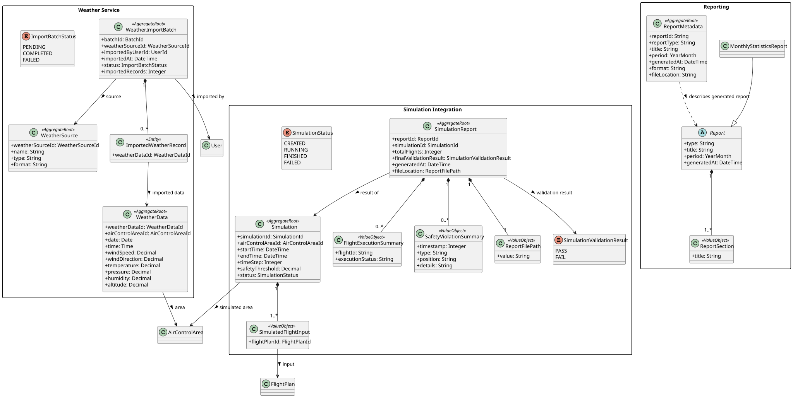
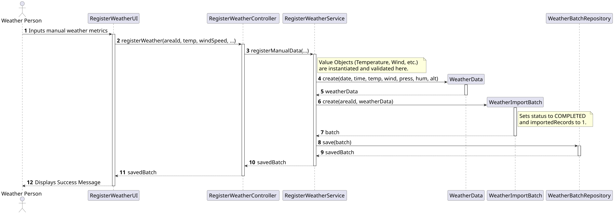

# US041 - Register weather data

## 1. Requirements Engineering

### 1.1. User Story Description
As a Weather Person, I want to register weather data in the system for a specific air control area.

### 1.2. Context & Constraints
This User Story addresses the **manual**, single-entry registration of weather data by a user. However, the system's overarching architecture requires weather data to be tracked within an import batch (primarily to support bulk imports in future sprints).

### 1.3. Dependencies
* **Authentication:** The user must be authenticated as a Weather Person.

## 2. Analysis & Domain Model

To strictly align with the team's UML model, `WeatherData` is an `<<Entity>>` rather than an Aggregate Root. It is managed by the `WeatherImportBatch` `<<AggregateRoot>>`. To satisfy US041 (manual single registration) without breaking this DDD architecture, we treat manual registration as generating an instantly completed "Batch" containing exactly 1 `WeatherData` record.

* **Aggregate Root:** `WeatherImportBatch` (Tracks timestamp, `COMPLETED` status, area ID, and number of imported records).
* **Entity:** `WeatherData` (Holds separate `LocalDate` and `LocalTime` fields).
* **Value Objects:** `Wind` (Validates speed >= 0 knots, direction 0-359 degrees).
    * `Temperature` (Validates realistic Earth values: -90C to +60C).
    * `Humidity` (Validates 0-100 percentage).
    * `AtmosphericPressure` (Validates 800-1150 hPa).
    * `Altitude` (Validates -500m to 50000m).

## 3. Design

### 3.1. Architecture & Flow
1. **Controller (`RegisterWeatherController`):** Exposes the registration action to the presentation layer.
2. **Application Service (`RegisterWeatherService`):** Instantiates the rigorous Value Objects, wraps them into a `WeatherData` entity, and injects that entity into a new `WeatherImportBatch` mapped to the selected `airControlAreaId`.
3. **Repository (`WeatherBatchRepository`):** Handles saving the Aggregate Root. Using JPA `CascadeType.ALL`, persisting the Batch automatically persists the nested `WeatherData` entity.

## 4. Implementation Details

* **Date and Time Separation:** As defined by the relational schema, the system timestamp at the moment of registration is cleanly split into `LocalDate` and `LocalTime` within the entity.
* **Batch Instantiation:** A specialized constructor exists in `WeatherImportBatch` specifically for manual entries, which hardcodes the batch status to `COMPLETED` and sets the record count to `1`.
* **Persistence:** Handled by `JpaWeatherBatchRepository` and `InMemoryWeatherBatchRepository`.

## 5. Testing

* **Physical Constraints (Domain Tests):** Tests guarantee that negative wind speeds (`WindTest`), humidity above 100% (`HumidityTest`), or atmospheric pressures outside Earth's realistic bounds (`AtmosphericPressureTest`) throw exceptions.
* **Service Flow:** `RegisterWeatherServiceTest` utilizes the In-Memory Repository to simulate database actions. It asserts that a successful manual insertion produces exactly one Batch, containing exactly one Record, tied to the correct Air Control Area ID.

---

## 6. UML Diagrams

### 6.1. Domain Class Diagram

### 6.2. Sequence Diagram

