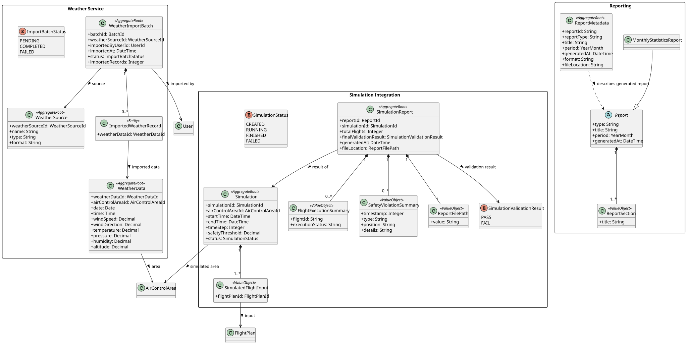
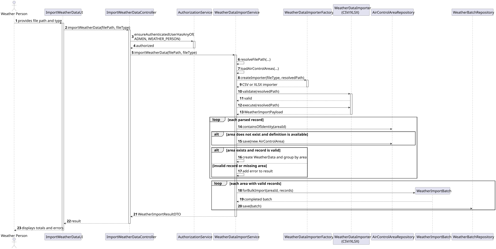

# US042 - Import Bulk Weather Data

## 1. Requirements Engineering

### 1.1. User Story

As a Weather Person, I want to import weather data in bulk from a file so that it can be used by the system.

### 1.2. Acceptance Criteria

- Only authenticated users with the `WEATHER_PERSON` or `ADMIN` role can perform the import.
- The system accepts CSV and XLSX weather files.
- Each record is validated using the weather domain value objects.
- Valid records are grouped by Air Control Area and persisted in a `WeatherImportBatch`.
- Invalid records are rejected and reported with their source line.
- When an Air Control Area does not exist, the system attempts to create it from the ACA data supplied in the CSV companion file or XLSX workbook.
- The result reports the total, imported and rejected record counts, as well as validation errors.

### 1.3. Dependencies

- **US030:** Authentication and authorization.
- **US041:** Weather domain model and validation rules.
- **US050:** Air Control Area registration.

## 2. Analysis

`WeatherImportBatch` is the aggregate root responsible for a collection of imported `WeatherData` entities. The import is performed synchronously and creates one completed batch for each Air Control Area containing valid records.

The importer strategy isolates file parsing from the application service:

- `WeatherDataCSVImporter` parses CSV files.
- `WeatherDataXLSXImporter` parses XLSX workbooks.
- `WeatherDataImporterFactory` selects the importer from the supplied type or file extension.
- `WeatherImportPayload` carries parsed records and parsing errors.

## 3. Design

### 3.1. Main Flow

1. `ImportWeatherDataUI` collects the file path and optional file type.
2. `ImportWeatherDataController` verifies that the current user has the required role.
3. `WeatherDataImportService` resolves the file path and loads available Air Control Area definitions.
4. `WeatherDataImporterFactory` returns the CSV or XLSX importer.
5. The importer validates and parses the file into a `WeatherImportPayload`.
6. For each record, the service checks the associated Air Control Area and creates it when a valid definition is available.
7. Domain value objects validate wind, temperature, pressure, humidity and altitude.
8. Valid records are grouped by area and persisted through `WeatherBatchRepository`.
9. The UI receives a `WeatherImportResultDTO` and displays totals and errors.

### 3.2. Alternative Flows

- An unsupported file type or invalid path causes an `IllegalArgumentException`.
- A record referencing an unknown area without an ACA definition is rejected.
- A record that violates domain constraints is rejected without preventing other valid records from being imported.
- Parsing errors are added to the final import report.

## 4. Implementation

The implementation uses `WeatherDataImportService` as the application orchestrator, `AirControlAreaRepository` to verify or create areas, and `WeatherBatchRepository` to persist each bulk import aggregate.

CSV ACA definitions are read from a companion file whose name uses the `-ACA.csv` suffix. In XLSX imports, ACA definitions are read from the same workbook. Imported altitude is calculated from the lower and upper flight-level limits and converted from feet to metres.

For a detailed view of the classes, responsibilities and implementation decisions, see the [Structure and Implementation document](weather_impl_structure.md).

## 5. Tests

### 5.1. Application Service Tests

- `WeatherDataImportServiceTest` verifies that a valid CSV file creates a
  `WeatherImportBatch` for the corresponding Air Control Area and imports all
  valid records.
- `WeatherDataImportServiceTest` verifies that a missing Air Control Area is
  automatically created from the companion ACA file before its weather data is
  persisted.
- `WeatherDataImportServiceTest` verifies that unsupported file types are
  rejected with an `IllegalArgumentException`.

### 5.2. Controller and Authorization Tests

- `ImportWeatherDataControllerTest` verifies that the controller delegates the
  import to `WeatherDataImportService`.
- The same test verifies that access is checked for the `ADMIN` and
  `WEATHER_PERSON` roles before processing the file.
- The test also confirms that the returned result contains the expected
  imported and rejected record counts.

### 5.3. Importer Tests

- `WeatherDataCSVImporterTest` covers CSV validation, header mapping, parsing
  of wind records and reporting of malformed rows.
- `WeatherDataXLSXImporterTest` covers XLSX validation, detection of the header
  row, extraction of weather records and invalid workbook data.
- Importer tests verify the mapping of the ACA identifier, altitude limits,
  wind direction, wind speed, date and time interval into `WeatherDataDTO`.

### 5.4. Domain and Persistence Tests

- `WeatherImportBatchTest` verifies batch creation rules for manual and bulk
  imports, including the required Air Control Area and import status.
- Weather value object tests validate physical limits for `Wind`,
  `Temperature`, `Humidity`, `AtmosphericPressure` and `Altitude`.
- `InMemoryWeatherBatchRepositoryTest` verifies storage and lookup by Air
  Control Area in the in-memory repository.
- `JpaWeatherBatchRepositoryTest` verifies that saving a
  `WeatherImportBatch` persists its associated `WeatherData` records through
  the JPA repository.

### 5.5. Main Test Scenarios

| Scenario | Expected result |
|---|---|
| Valid CSV or XLSX file | Valid records are imported and grouped by Air Control Area |
| Missing area with a valid ACA definition | The area is created and its records are imported |
| Missing area without an ACA definition | The affected records are rejected and an error is reported |
| Record outside domain limits | The record is rejected without stopping the remaining import |
| Malformed source row | The source line and parsing error are included in the result |
| Unsupported file type or invalid path | The import is refused with an exception |
| Unauthorized user | Access is denied before the application service is executed |

## 6. UML Diagrams

### 6.1. Domain Model

### 6.2. Sequence Diagram

PlantUML source: [SD.puml](SD.puml).
