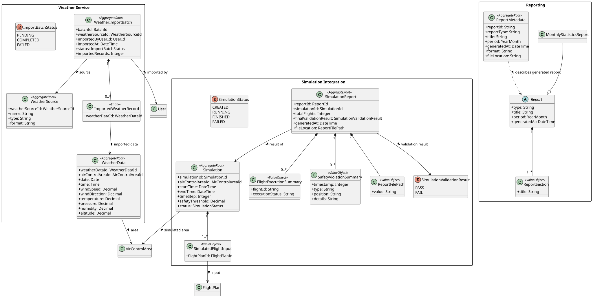
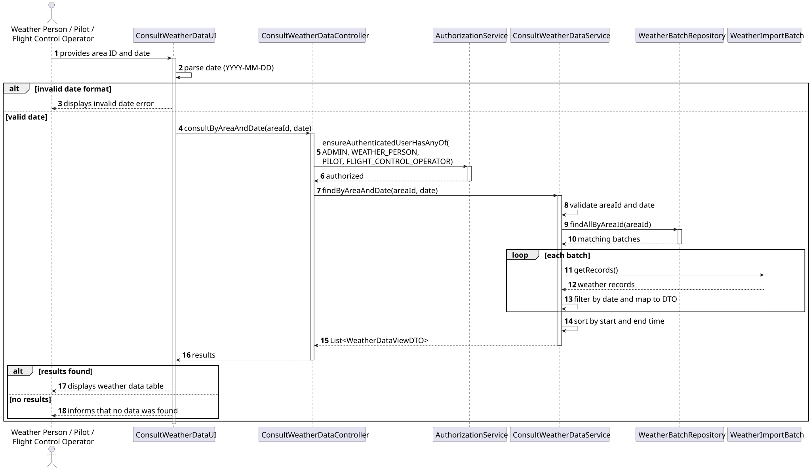

# US043 - Consult Weather Data

## 1. Requirements Engineering

### 1.1. User Story

As a Weather Person, a Pilot, or a Flight Control Operator, I want to
consult weather data in the system for a given day and a specific Air Control
Area.

### 1.2. Context

Weather data is used by different actors and can support flight plan
validation, simulation and environmental influence calculations. This user
story complements US041 and US042 by allowing the data registered manually or
imported in bulk to be consulted.

### 1.3. Dependencies

- **US030:** Authentication and authorization.
- **US041:** Register weather data.
- **US042:** Import bulk weather data.
- **US050:** Register an Air Control Area.

### 1.4. Acceptance Criteria

- The system allows weather data to be consulted by day.
- The system allows weather data to be consulted by Air Control Area.
- Only authorized users can access the functionality.
- Existing weather data is displayed clearly.
- When no data exists for the selected day and area, the user is informed.

### 1.5. Definition of Done

- Consultation use case implemented.
- Search by date implemented.
- Search by Air Control Area implemented.
- Access permissions validated.
- Unit tests created.
- Documentation updated.
- CI passes successfully.

## 2. Analysis

Weather data is stored inside `WeatherImportBatch` aggregate roots. Each batch
belongs to one Air Control Area and contains one or more `WeatherData` records.

The consultation follows two filtering levels:

1. `WeatherBatchRepository.findAllByAreaId()` retrieves the batches belonging
   to the selected Air Control Area.
2. `ConsultWeatherDataService` filters the records inside those batches by the
   selected date.

Matching records from all batches are combined and sorted by start time and
then by end time. Domain entities are mapped to `WeatherDataViewDTO` objects so
that the presentation layer does not depend directly on the aggregate.

## 3. Design

### 3.1. Main Flow

1. The user selects **Consult Weather Data**.
2. `ConsultWeatherDataUI` requests an Air Control Area identifier and a date in
   `YYYY-MM-DD` format.
3. `ConsultWeatherDataController` verifies that the authenticated user has one
   of the allowed roles.
4. `ConsultWeatherDataService` validates the area identifier and date.
5. The service obtains all batches associated with the selected area.
6. Records are filtered by date and mapped to `WeatherDataViewDTO`.
7. Results are sorted by their start and end times.
8. The UI displays the matching weather data in tabular form.

### 3.2. Authorization

Access is allowed to:

- `ADMIN`;
- `WEATHER_PERSON`;
- `PILOT`;
- `FLIGHT_CONTROL_OPERATOR`.

Authorization is checked in `ConsultWeatherDataController` before the service
and repository are accessed.

### 3.3. Alternative Flows

- If the date does not use the `YYYY-MM-DD` format, the UI displays an invalid
  date error.
- If the Air Control Area identifier is null or blank, the service throws an
  `IllegalArgumentException`.
- If the date is null, the service throws an `IllegalArgumentException`.
- If no matching record exists, the UI informs the user instead of displaying
  an empty table.
- If the user does not have an authorized role, access is denied before the
  consultation is executed.

## 4. Implementation

### 4.1. Main Components

- `ConsultWeatherDataUI` collects the filters and displays the results.
- `ConsultWeatherDataController` applies role-based authorization and
  delegates the request.
- `ConsultWeatherDataService` validates input, filters records, sorts results
  and maps domain entities to view DTOs.
- `WeatherBatchRepository` retrieves all weather batches for an Air Control
  Area.
- `WeatherDataViewDTO` exposes the weather values required by the UI.

### 4.2. Presented Data

For every matching record, the console table displays:

- start and end time;
- temperature in degrees Celsius;
- wind speed in knots and direction in degrees;
- atmospheric pressure in hPa;
- humidity percentage;
- altitude in metres.

Both `InMemoryWeatherBatchRepository` and `JpaWeatherBatchRepository` implement
the area-based lookup. The JPA implementation fetches the records together
with their batches to make them available after the persistence context is
closed.

## 5. Tests

### 5.1. Application Service Tests

- `ConsultWeatherDataServiceTest` verifies that only records matching both the
  requested Air Control Area and date are returned.
- The test confirms that records from another area are excluded.
- The test confirms that records from another date are excluded.
- The returned DTO is checked for the expected area, date, start time and end
  time.
- A blank Air Control Area identifier is rejected with an
  `IllegalArgumentException`.
- A null date is rejected with an `IllegalArgumentException`.

### 5.2. Controller and Authorization Tests

- `ConsultWeatherDataControllerTest` verifies that the controller returns the
  filtered weather data supplied by the service.
- It confirms that the start and end times are correctly exposed in the
  returned DTO.
- It verifies that authorization is requested for `ADMIN`, `WEATHER_PERSON`,
  `PILOT` and `FLIGHT_CONTROL_OPERATOR`.

### 5.3. Main Test Scenarios

| Scenario | Expected result |
|---|---|
| Existing area and date | Matching weather records are displayed |
| Multiple batches for the same area | Matching records from all batches are combined |
| Records from another date | Records are excluded |
| Records from another area | Records are excluded |
| No matching data | The user is informed that no weather data was found |
| Blank area identifier | The request is rejected |
| Invalid or missing date | The request is rejected with a clear error |
| Unauthorized role | Access is denied before searching the repository |

## 6. UML Diagrams

### 6.1. Domain Model

### 6.2. Sequence Diagram

PlantUML source: [SD.puml](SD.puml).
