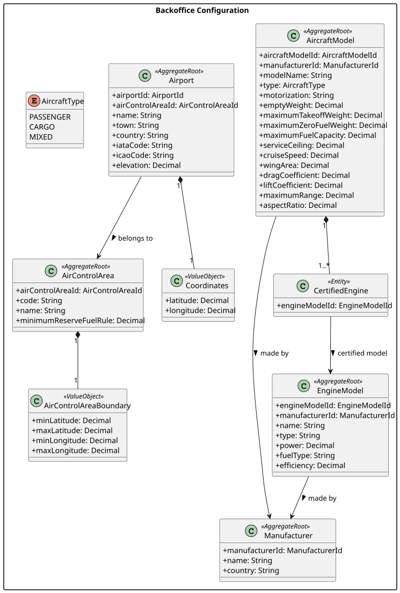
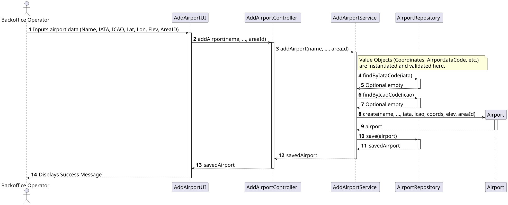

# US052 - Create an airport

## 1. Requirements Engineering

### 1.1. User Story Description
As a Backoffice Operator, I want to register an airport in a given air control area.

### 1.2. Acceptance Criteria
* An airport must be associated with exactly one air control area.
* The airport has an ICAO code (exactly 4 letters) that must be unique worldwide.
* The airport has an IATA code (exactly 3 letters) that must be unique worldwide.
* An airport has location coordinates (Latitude and Longitude) that must be valid.
* An airport has an elevation in meters above sea level.
* This feature must also be achievable by a bootstrap process.

### 1.3. Dependencies
* **Authentication:** The user must be authenticated as a Backoffice Operator.
* **US050:** Air Control Areas should ideally exist in the system to link the airport properly, though the ID can be referenced loosely as a String in the domain.

## 2. Analysis & Domain Model

The Airport operates as an independent entity with its own lifecycle, making it an `<<AggregateRoot>>`. Crucially, because Airport codes have different physical constraints than Air Transport Company codes (e.g., 3 letters vs. 2 letters), we established strict, domain-specific Value Objects to prevent cross-contamination of invalid data.

* **Aggregate Root:** `Airport`
* **Value Objects:** `AirportIataCode`: Strictly enforces a 3-letter regex.
    * `AirportIcaoCode`: Strictly enforces a 4-letter regex.
    * `Coordinates`: Validates Earth boundaries (Latitude between -90 and 90; Longitude between -180 and 180).
    * `Elevation`: Stores meters above sea level.
* **Relationships:** The `Airport` holds an `airControlAreaId` (String) to reference the Air Control Area Aggregate without tightly coupling the object graphs.

## 3. Design

### 3.1. Architecture & Flow
1. **Controller (`AddAirportController`):** Receives primitive types from the UI and passes them to the Service.
2. **Application Service (`AddAirportService`):** Orchestrates the process. It validates the global uniqueness of the Airport IATA and ICAO codes via the Repository before instantiating the Domain Aggregate and persisting it.
3. **Repository (`AirportRepository`):** Provides custom query methods `findByIataCode` and `findByIcaoCode`.

## 4. Implementation Details

* **Persistence:** Created `JpaAirportRepository` for production database environments and `InMemoryAirportRepository` for test environments.
* **Bootstrap:** Added `AirportBootstrapper` to pre-load critical global airports (e.g., Francisco Sá Carneiro, Humberto Delgado) upon system initialization.

## 5. Testing

* **Value Object Boundaries:** `CoordinatesTest` explicitly proves that invalid physical locations (e.g., Latitude 91.0 or Longitude -181.0) instantly throw an `IllegalArgumentException`.
* **Domain Isolation:** `AirportIataCodeTest` verifies that a 2-letter string (which is valid for an airline) explicitly fails and crashes when passed to the Airport domain.
* **Service Flow:** `AddAirportServiceTest` uses a Fake Repository to simulate the database, guaranteeing that an `IllegalStateException` is thrown if a user attempts to register an airport with an IATA or ICAO code that already exists.

---

## 6. UML Diagrams

### 6.1. Domain Class Diagram

### 6.2. Sequence Diagram

