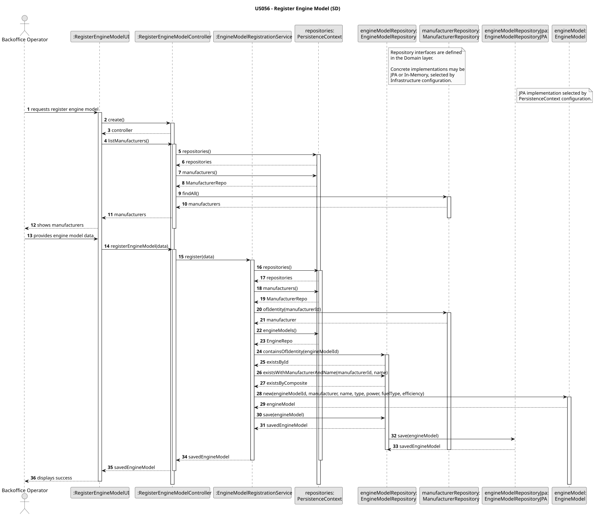

# US056 - Registar um novo modelo de motor

## 1. Engenharia de Requisitos

### 1.1 User Story

Como Operador de Backoffice, quero registar um novo modelo de motor para ser usado por aeronaves.

### 1.2 Contexto

Os modelos de motor definem caracteristicas de motorizacao usadas para certificacao, desempenho e
simulacao de aeronaves. Sao registados de forma independente para que varios modelos de aeronave
possam referenciar o mesmo modelo de motor quando a certificacao for necessaria.

### 1.3 Criterios de Aceitacao
- Operador de Backoffice pode registar novos modelos de motor.
- A combinacao nome + fabricante e validada como unica.
- As especificacoes do motor (tipo, potencia, combustivel, eficiencia) sao corretamente capturadas.
- O processo de bootstrap carrega com sucesso os dados de motores.

### 1.4 Dependencias
- Registo de fabricantes e bootstrap (os modelos de motor exigem fabricantes existentes).

---

## 2. Analise

O caso de uso de registo deve:
- permitir ao Operador de Backoffice selecionar um fabricante existente;
- recolher o codigo e o nome do modelo de motor;
- recolher caracteristicas tecnicas (tipo, potencia, tipo de combustivel, eficiencia);
- validar a unicidade da combinacao fabricante + nome;
- persistir o modelo de motor;
- ser executavel via bootstrap para seed de dados iniciais.

A operacao deve respeitar a arquitetura em camadas:

```text
Presentation -> Application -> Domain -> Infrastructure
```

---

## 3. Desenho

### 3.1 Abordagem Arquitetural

O caso de uso segue o fluxo generico com service (UI -> Controller -> Service -> Repository). Isto
mantem a logica da UI minima, centraliza a coordenacao no controller/service e isola o acesso a
persistencia por interfaces de repositorio.

### 3.2 Componentes Principais

#### Camada de Apresentacao
Package:

```text
pt.isep.sem4pi.presentation.engineModel
```

Componentes:
- `RegisterEngineModelUI`
- `RegisterEngineModelAction`

Responsabilidades:
- recolher input do utilizador;
- listar fabricantes para selecao;
- apresentar resultados do registo.

#### Camada de Aplicacao
Packages:

```text
pt.isep.sem4pi.application.controller.engineModel
pt.isep.sem4pi.application.service.engineModel
```

Componentes:
- `RegisterEngineModelController`
- `EngineModelRegistrationService`

Responsabilidades:
- garantir regras de autorizacao (Backoffice Operator/Admin);
- coordenar o workflow de registo;
- validar existencia e unicidade via repositorios.

#### Camada de Dominio
Package:

```text
pt.isep.sem4pi.domain.model.engineModel
```

Componentes:
- `EngineModel`
- `EngineModelId`
- `EngineType`
- `FuelType`

Responsabilidades:
- representar o agregado de modelo de motor;
- garantir invariantes (nao nulo, potencia/eficiencia positivas).

Repositorios:

```text
pt.isep.sem4pi.domain.repositories.EngineModelRepository
```

#### Camada de Infraestrutura
Packages:

```text
pt.isep.sem4pi.infrastructure.persistence.JPA
pt.isep.sem4pi.infrastructure.persistence.memory
pt.isep.sem4pi.infrastructure.bootstrap
```

Componentes:
- `JpaEngineModelRepository`
- `InMemoryEngineModelRepository`
- `BackofficeConfigurationBootstrapper`

Responsabilidades:
- fornecer implementacoes de persistencia;
- inicializar dados de motores.

---

### 3.3 Fluxo de Registo (com Service)

```text
RegisterEngineModelUI
 -> RegisterEngineModelController
 -> EngineModelRegistrationService
 -> ManufacturerRepository
 -> EngineModelRepository
```

### 3.4 Regras de Validacao

Validadas nas camadas de aplicacao e dominio:
- existencia de fabricante (`ManufacturerRepository.ofIdentity`);
- unicidade do codigo do modelo (`EngineModelRepository.containsOfIdentity`);
- unicidade fabricante + nome (`EngineModelRepository.existsWithManufacturerAndName`);
- potencia e eficiencia maiores que zero (invariantes do construtor de `EngineModel`).

### 3.5 Estrategia de Persistencia

A interface de repositorio e implementada por:
- `JpaEngineModelRepository` (JPA);
- `InMemoryEngineModelRepository` (in-memory).

A implementacao selecionada e resolvida pela configuracao de `PersistenceContext`.

### 3.6 Bootstrap

`BackofficeConfigurationBootstrapper` regista fabricantes e modelos de motor se ainda nao existirem.
Isto garante execucao repetivel do bootstrap sem duplicacoes.

---

## 4. Diagramas

### 4.1 Diagrama de Sequencia



---

## 5. Notas de Implementacao

Principais referencias de ficheiros:
- UI: `src/main/java/pt/isep/sem4pi/presentation/engineModel/RegisterEngineModelUI.java`
- Controller: `src/main/java/pt/isep/sem4pi/application/controller/engineModel/RegisterEngineModelController.java`
- Service: `src/main/java/pt/isep/sem4pi/application/service/engineModel/EngineModelRegistrationService.java`
- Modelo de dominio: `src/main/java/pt/isep/sem4pi/domain/model/engineModel/EngineModel.java`
- Interface de repositorio: `src/main/java/pt/isep/sem4pi/domain/repositories/EngineModelRepository.java`
- Repositorio JPA: `src/main/java/pt/isep/sem4pi/infrastructure/persistence/JPA/JpaEngineModelRepository.java`
- Repositorio in-memory: `src/main/java/pt/isep/sem4pi/infrastructure/persistence/memory/InMemoryEngineModelRepository.java`
- Bootstrap: `src/main/java/pt/isep/sem4pi/infrastructure/bootstrap/BackofficeConfigurationBootstrapper.java`

---

## 6. Testes

Testes adicionados para a US056:
- Service: `src/test/java/pt/isep/sem4pi/application/service/engineModel/EngineModelRegistrationServiceTest.java`
- Controller: `src/test/java/pt/isep/sem4pi/application/controller/engineModel/RegisterEngineModelControllerTest.java`
- Dominio: `src/test/java/pt/isep/sem4pi/domain/model/engineModel/EngineModelTest.java`
- Value Object: `src/test/java/pt/isep/sem4pi/domain/model/engineModel/EngineModelIdTest.java`
- Persistencia (in-memory): `src/test/java/pt/isep/sem4pi/infrastructure/persistence/InMemoryEngineModelRepositoryTest.java`

---

## 7. Conclusao

A implementacao da US056 regista modelos de motor numa arquitetura em camadas com um fluxo baseado
em service, valida unicidade e restricoes tecnicas, e suporta inicializacao automatica via bootstrap.
