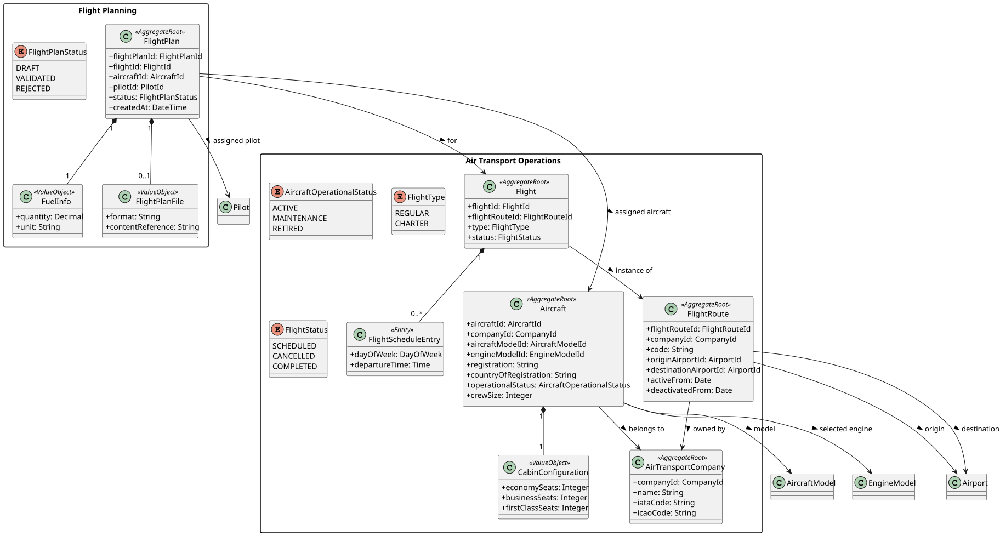
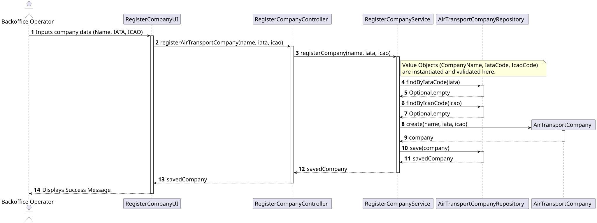

# US060 - Register an air transport company

## 1. Requirements Engineering

### 1.1. User Story Description
As a Backoffice Operator, I want to register an air transport company.

### 1.2. Acceptance Criteria
* A company has a company name.
* A company has an IATA code (exactly 2 letters) that must be globally unique.
* A company has an ICAO code (2 to 3 letters) that must be globally unique.
* This feature must also be achievable by a bootstrap process.

### 1.3. Dependencies
* **Authentication:** The user must be authenticated as a Backoffice Operator to access this feature.

## 2. Analysis & Domain Model

The Air Transport Company was modeled as an independent Aggregate Root to guarantee data consistency and enforce its specific business invariants.

* **Aggregate Root:** `AirTransportCompany`
* **Value Objects:**  `CompanyName`: Enforces that the string cannot be null or empty.
    * `IataCode`: Validates via regex that the code is exactly 2 letters.
    * `IcaoCode`: Validates via regex that the code is between 2 and 3 letters.

By utilizing these Value Objects, we guarantee that no invalid company data can ever be instantiated in memory or persisted to the database.

## 3. Design

### 3.1. Architecture & Flow
To enforce a strict separation of concerns, the Presentation Layer (UI) delegates execution to an Application Service via a Controller.

1. **Controller (`RegisterAirTransportCompanyController`):** Receives primitive types (Strings) from the UI and passes them to the Service. It catches domain exceptions and returns readable error messages to the Presentation layer.
2. **Application Service (`RegisterAirTransportCompanyService`):** Orchestrates the use case. It converts the primitive inputs into Value Objects (triggering domain validation). It then queries the Repository to enforce the global business rule (IATA and ICAO uniqueness). Finally, it instantiates the Domain Aggregate and saves it.
3. **Repository (`AirTransportCompanyRepository`):** Handles persistence and provides custom query methods like `findByIataCode` and `findByIcaoCode`.

## 4. Implementation Details

* **Database Persistence:** Implemented `JpaAirTransportCompanyRepository` to handle relational database mapping, fulfilling the project's configurable database constraint.
* **In-Memory Persistence:** Implemented `InMemoryAirTransportCompanyRepository` to support rapid, isolated unit testing without requiring a database connection.
* **System Bootstrap:** Developed `AirTransportCompanyBootstrapper` to inject predefined airlines (e.g., TAP Air Portugal, Ryanair) upon system startup.

## 5. Testing

* **Domain Unit Tests:** `IataCodeTest`, `IcaoCodeTest`, and `CompanyNameTest` thoroughly assert boundary conditions. Tests prove that invalid string lengths, numbers, and null values immediately throw an `IllegalArgumentException`.
* **Service Unit Tests:** `RegisterCompanyServiceTest` utilizes a custom Fake Repository pattern to test the Application Service's logic in isolation. It verifies that an `IllegalStateException` is correctly thrown if an IATA or ICAO code already exists in the system.

---

## 6. UML Diagrams

### 6.1. Domain Class Diagram

### 6.2. Sequence Diagram

