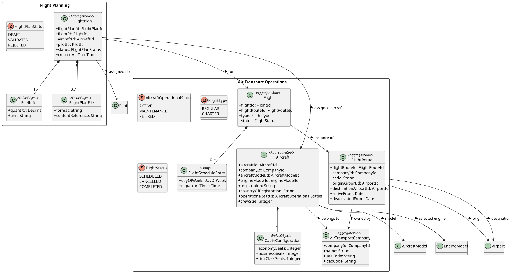
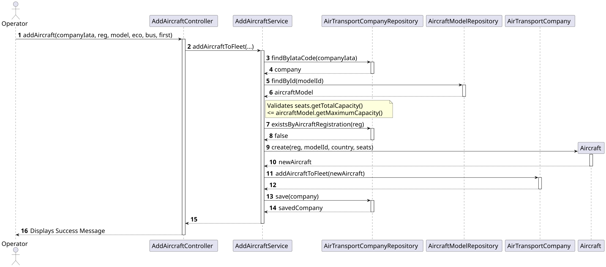

# US070 - Add an aircraft to the fleet

## 1. Requirements Engineering

### 1.1. User Story Description
As a Backoffice Operator, I want to add an aircraft to an air transport company's fleet.

### 1.2. Acceptance Criteria
* An aircraft belongs to a specific Air Transport Company.
* An aircraft must be mapped to an existing Aircraft Model in the system.
* The total number of seats configured in the cabin cannot exceed the maximum capacity defined by the Aircraft Model.
* The aircraft registration must be globally unique across the entire system.

### 1.3. Dependencies
* **Authentication:** The user must be authenticated as a Backoffice Operator.
* **US060:** The target Air Transport Company must already exist in the system.
* **US055:** The target Aircraft Model must already exist in the system to validate the seating capacity.

## 2. Analysis & Domain Model

According to Domain-Driven Design (DDD) principles, validating this User Story requires **Cross-Aggregate Validation**. `AirTransportCompany` and `AircraftModel` are entirely separate Aggregate Roots with their own lifecycles.

* **Aggregate Roots:** `AirTransportCompany`, `AircraftModel`.
* **Entity:** `Aircraft` (Local to and dependent on the `AirTransportCompany` aggregate).
* **Value Objects:** `AircraftRegistration`: Guarantees the registration string is non-empty, non-null, and strictly formatted in uppercase.
    * `CabinConfiguration`: Centralizes seat validation (Economy, Business, and First Class). Ensures no individual values are negative and the total seat count is strictly greater than zero.

## 3. Design

### 3.1. Architecture & Flow
The use case execution follows a strict separation of concerns across the application layers:

1. **Presentation Layer (`AddAircraftUI`):** Collects primitive data from the user and passes it to the Controller.
2. **Controller (`AddAircraftController`):** Acts as an intermediary, delegating the operation to the Application Service and returning responses or formatted error messages.
3. **Application Service (`AddAircraftService`):** Orchestrates the core business logic. It instantiates the Value Objects (triggering intrinsic domain validations), loads the `AirTransportCompany`, loads the target `AircraftModel`, performs the cross-aggregate seat limit validation, checks for global registration uniqueness, and finally appends the newly created `Aircraft` entity to the company's fleet.
4. **Repositories:**
* `AirTransportCompanyRepository`: Includes a custom `existsByAircraftRegistration(registration)` method (implemented in both JPA and In-Memory) to enforce global registration uniqueness prior to saving.
* `AircraftModelRepository`: Used strictly for querying the structural limits of the model.

## 4. Implementation Details

* **Cascade Saving:** Persistence on the `AirTransportCompany` side utilizes `@OneToMany(cascade = CascadeType.ALL, orphanRemoval = true)`. This guarantees that saving the updated company aggregate atomically inserts the new `Aircraft` entity into the relational database without needing an independent Aircraft repository.
* **Database Queries:** The global uniqueness check utilizes a customized JPQL query to efficiently count matching registration strings across all company fleets without loading the entire database into memory.

## 5. Testing

* **Success Path:** Validates that a cabin configuration of 150 seats is successfully accepted and saved into an A320 model (which dictates a limit of 180 seats).
* **Cross-Aggregate Validation:** Proves that attempting to add 200 seats to an A320 immediately throws an `IllegalStateException`, successfully blocking the database save.
* **Global Uniqueness:** Demonstrates that attempting to register an aircraft registration that already exists anywhere in the system fails with an `IllegalStateException`.

---

## 6. UML Diagrams (PlantUML)

### 6.1. Domain Class Diagram

### 6.2. Sequence Diagram

