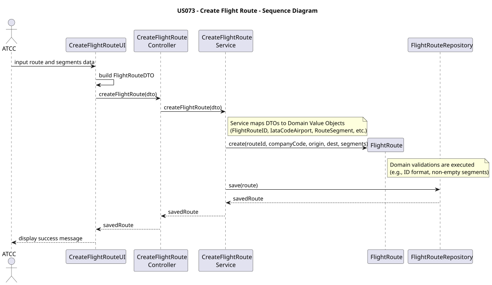
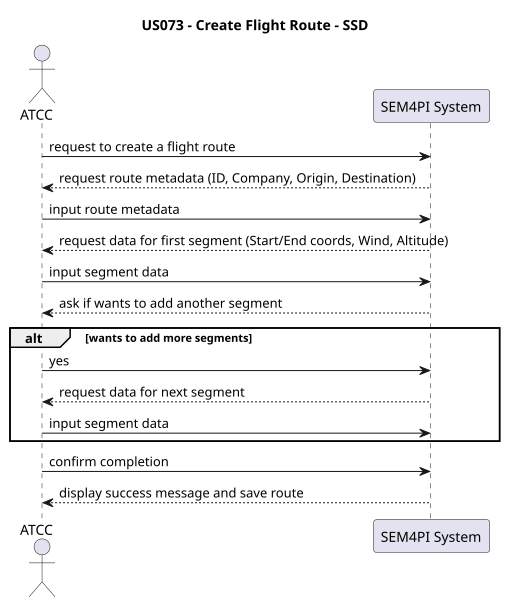

# US073 — Create Flight Route

## 1. Requirements Engineering

### 1.1 User Story

As an Air Transport Company Collaborator, I want to create a new flight route.

---

## 1.2 Context

An Air Transport Company operates flights between various airports globally. Before a flight can be scheduled, the underlying navigational path—the flight route—must be defined in the system.

A flight route is not just a straight line between two airports; it is composed of one or more route segments (waypoints) characterized by specific geographical coordinates, altitude ranges, maximum speeds, and expected wind conditions. The Air Transport Company Collaborator is responsible for inputting this data accurately so it can be used later for flight scheduling and trajectory calculations.

---

## 1.3 Acceptance Criteria

* The user must be authenticated and authorized as an `AIR_TRANSPORT_COMPANY_COLLABORATOR`.
* The flight route must have a unique identifier (`FlightRouteID`) that strictly starts with the Company's IATA code.
* The route must define a valid origin and destination airport (using IATA codes).
* The route must contain at least one valid navigational segment (`RouteSegment`).
* Each segment must define start and end coordinates, wind conditions, and available altitude ranges.
* The system must validate the integrity of the data (no null values, valid coordinate ranges, etc.) before saving.

---

## 1.4 Dependencies

This user story depends on:
* **System Users / Authentication:** The user must be logged in with the correct role.
* **Company / Airports (Contextual):** While the airports and companies might exist independently, the route relies on their IATA codes for identification.

---

# 2. Analysis

This use case represents the creation of a new core Aggregate in the system: `FlightRoute`.

Following Domain-Driven Design (DDD) principles:
1. **Data Transfer:** Because a route contains complex nested data (Segments, Coordinates, Winds, Altitudes), passing multiple separate parameters from the UI to the Controller/Service is unviable. The system uses a Data Transfer Object (`FlightRouteDTO` and `RouteSegmentDTO`) to securely carry this data across layers.
2. **Encapsulation:** The `FlightRoute` aggregate enforces its own business rules upon instantiation (e.g., ensuring the ID matches the company code and that the segment list is not empty).
3. **Persistence:** Once validated and instantiated, the Application Service delegates the persistence to the `FlightRouteRepository`.

---

# 3. Design

## 3.1 Architectural Approach

The implementation follows the standard layered architecture:

Presentation -> Application -> Domain -> Infrastructure

| Layer          | Responsibility |
| -------------- | -------------- |
| Presentation   | Prompts the user for route details and segments, constructs the DTO. |
| Application    | Receives the DTO, orchestrates the creation, and manages the transaction. |
| Domain         | Instantiates the Aggregate, validates business rules (ID formats, null checks). |
| Infrastructure | Saves the newly created `FlightRoute` to the database. |

---

## 3.2 Main Components

### Presentation Layer
* `CreateFlightRouteUI`: Handles console inputs, allows the user to dynamically add multiple segments, and builds the `FlightRouteDTO`.

### Application Layer
* `CreateFlightRouteController`: Intermediary that receives the DTO from the UI.
* `CreateFlightRouteService`: Extracts data from the DTO, maps it to Domain Value Objects (VOs), and instantiates the `FlightRoute`.

### Domain Layer
* `FlightRoute`: The Aggregate Root.
* **Value Objects:** `FlightRouteID`, `IataCodeCompany`, `IataCodeAirport`, `RouteSegment`, `Coordinates`, `Wind`, `AltitudeRange`.
* `FlightRouteRepository`: Interface for persistence.

---

## 3.3 Creation Flow
1. The UI requests route metadata (ID, Company, Origin, Destination).
2. The UI enters a loop, asking the user to input data for one or more segments (Coordinates, Wind, Altitudes).
3. The UI packages all information into a `FlightRouteDTO` (which contains a list of `RouteSegmentDTO`).
4. The UI calls `controller.createFlightRoute(dto)`.
5. The Controller forwards the DTO to the `CreateFlightRouteService`.
6. The Service extracts the DTO primitives, instantiates the Domain VOs, and creates the `FlightRoute` entity.
7. The Service calls `save()` on the `FlightRouteRepository`.

---

# 4. Architecture Diagrams

### 4.1 System Sequence Diagram (SSD)

### 4.2 Sequence Diagram (SD)
