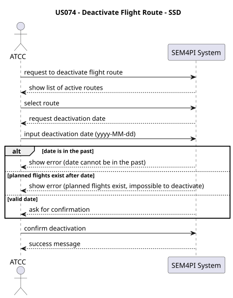
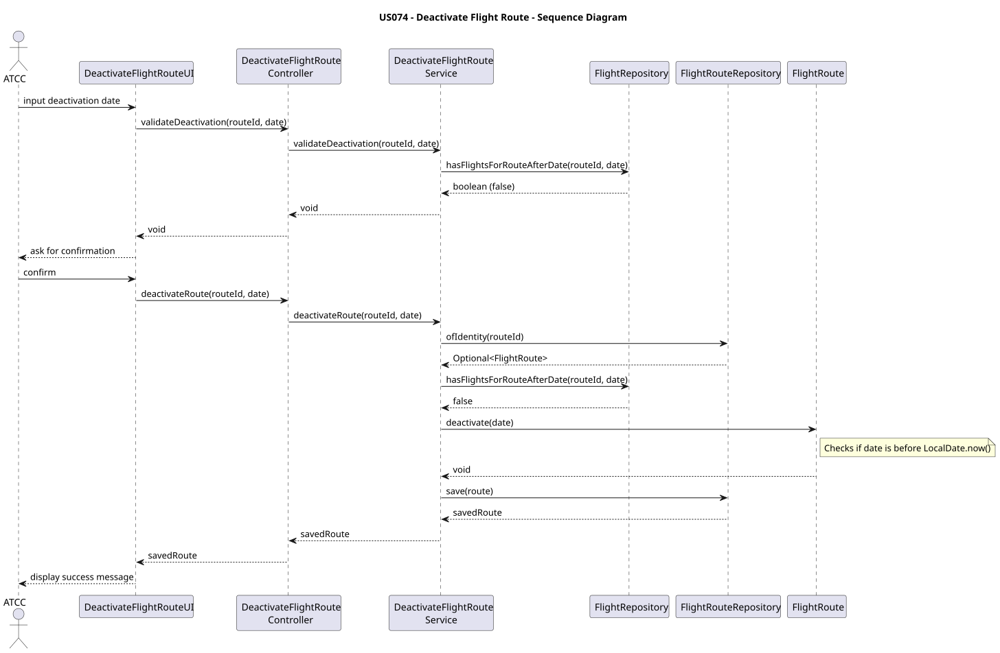

# US074 — Deactivate Flight Route

## 1. Requirements Engineering

### 1.1 User Story

As an Air Transport Company Collaborator, I want to deactivate a flight route from a given date onwards. No more flights can be created on a deleted flight route, and a route cannot be deleted if there are planned flights after that date.

---

## 1.2 Context

In the aviation industry, flight routes may become obsolete, unprofitable, or operationally unviable over time. An Air Transport Company Collaborator needs the ability to phase out these routes.

However, deleting a route physically from the database would corrupt the system's historical data (past flights that used this route would lose their reference). Therefore, a "Soft Delete" approach is required. Furthermore, the system must guarantee operational integrity: a route cannot be deactivated if there are already flights scheduled to fly that route on or after the intended deactivation date.

---

## 1.3 Acceptance Criteria

* The user must be authenticated and authorized as an `AIR_TRANSPORT_COMPANY_COLLABORATOR`.
* A route can only be deactivated from a specific date onwards.
* The deactivation date cannot be in the past (must be today or a future date).
* The system must block the deactivation if there are planned flights associated with this route on or after the deactivation date.
* Once deactivated, the system must prevent the creation of new flights for this route on or after the deactivation date.
* Historical data must remain intact (past flights remain linked to the route).

---

## 1.4 Dependencies

This user story depends on:
* **US073 (Create a flight route):** Routes must exist in the system to be deactivated.
* **US080 (Create a flight plan / Schedule Flight):** The existence of scheduled flights dictates whether the deactivation is permitted or blocked.

---

# 2. Analysis

This use case modifies the state of an existing aggregate (`FlightRoute`).

To comply with Domain-Driven Design (DDD) rules:
1. The `FlightRoute` aggregate must not access the database to check for flights. It is only responsible for holding its `deactivationDate` and enforcing internal rules (like rejecting past dates).
2. The Application Layer (`DeactivateFlightRouteService`) acts as the orchestrator. It queries the `FlightRepository` to verify the existence of conflicting future flights before instructing the `FlightRoute` to deactivate itself.
3. To improve User Experience (UX), validation occurs immediately upon user input in the UI, separating the validation check from the actual database save operation.

---

# 3. Design

## 3.1 Architectural Approach

The implementation follows the layered architecture adopted in the project:

Presentation -> Application -> Domain -> Infrastructure

Responsibilities:

| Layer          | Responsibility |
| -------------- | -------------- |
| Presentation   | User interaction, listing active routes, and capturing the date. |
| Application    | Use case orchestration, conflict validation, and transaction management. |
| Domain         | Business rules (rejecting past dates, validating active status). |
| Infrastructure | Database queries (checking for flights after a given date). |

---

## 3.2 Main Components

### Presentation Layer
Package: `pt.isep.sem4pi.presentation.route`
* `DeactivateFlightRouteUI`: Displays active routes, reads the date, and catches domain/service exceptions.

### Application Layer
Package: `pt.isep.sem4pi.application.controller.route` and `pt.isep.sem4pi.application.service.route`
* `DeactivateFlightRouteController`: Exposes operations to the UI.
* `DeactivateFlightRouteService`: Contains the core logic. Checks for flight conflicts and updates the route.

### Domain Layer
Packages: `pt.isep.sem4pi.domain.model.route` and `pt.isep.sem4pi.domain.repositories`
* `FlightRoute`: Aggregate root. Gains `deactivate(LocalDate)` and `isActiveOn(LocalDate)` methods.
* `FlightRepository`: Gains the specific query method `hasFlightsForRouteAfterDate(...)`.

---

## 3.3 Deactivation Flow
1. The UI asks the Controller for all routes.
2. The UI filters and displays only the active routes.
3. The user selects a route and inputs a date.
4. The UI calls `controller.validateDeactivation(...)`. If it fails (conflicting flights), the user is prompted again.
5. Upon confirmation, the UI calls `controller.deactivateRoute(...)`.
6. The Service fetches the route, verifies conflicts one last time (security measure), calls `route.deactivate()`, and saves it to the repository.

---

## 3.4 Design Decisions

### The "Soft Delete" Pattern
Instead of a database `DELETE`, a `deactivationDate` attribute (type `LocalDate`) was added to `FlightRoute`. A null value indicates the route is permanently active.

### Service-Level Conflict Validation
The rule "cannot be deleted if there are planned flights" crosses aggregate boundaries (Route vs Flight). Therefore, an Application Service (`DeactivateFlightRouteService`) was created to query the `FlightRepository` directly, preventing the `FlightRoute` aggregate from becoming coupled to infrastructure components.

### UI Pre-Validation
A `validateDeactivation` method was exposed to the UI so the user immediately knows if a date is invalid due to existing flights, rather than filling out an entire confirmation form only to get an error at the very end.

---

# 4. Architecture Diagrams

### 4.1 System Sequence Diagram (SSD)

### 4.2 Sequence Diagram (SD)

# 5. Tests and Implementation

The implementation includes comprehensive unit testing aiming to secure the new business rules.

Service Tests (DeactivateFlightRouteServiceTest)

    ensureDeactivateRouteSucceedsWhenNoPlannedFlightsExist: Happy path.

    ensureDeactivateRouteFailsWhenPlannedFlightsExistAfterDate: Throws IllegalStateException.

    ensureDeactivateRouteFailsWhenRouteNotFound: Throws IllegalArgumentException.

    ensureValidateDeactivationPassesWhenNoFlightsExist: Ensures validation method does not save to DB.

Controller Tests (DeactivateFlightRouteControllerTest)

    Validates correct delegation to the Service using Mockito.

    Validates exception propagation to the UI layer.

Domain Tests (FlightRouteTest)

    ensureDeactivateFailsWithPastDate: Tests domain-level protection against corrupting historical data.

    ensureDeactivateFailsWithNullDate.

    ensureIsActiveOnReturnsFalseOnOrAfterDeactivationDate: Verifies that scheduling flights on the exact day of deactivation is correctly blocked.

# 6. Conclusion

The implementation successfully fulfills US074. The solution protects the system's database integrity by using a "Soft Delete" architecture, allowing historical flight data to remain valid while strictly preventing the scheduling of new flights on discontinued routes. The separation of concerns is maintained, keeping the Domain Layer isolated from Database queries.