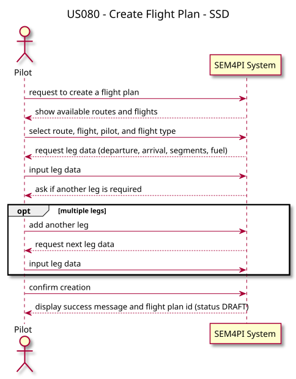
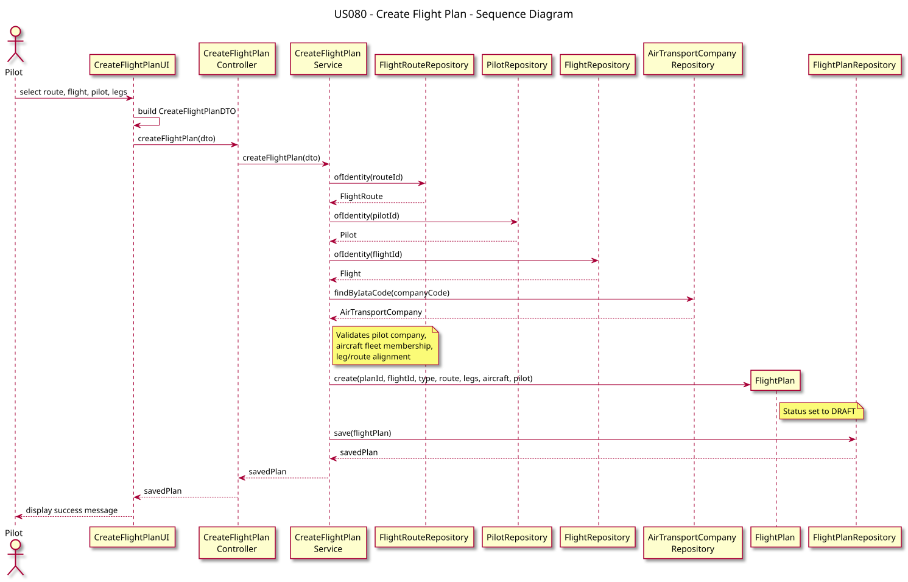

# US080 — Create a Flight Plan

## 1. Requirements Engineering

### 1.1 User Story

As a **Pilot**, I want to register a flight plan for a route. I must add the aircraft, departure date/time, fuel quantity, and pilot. The pilot must belong to the route's company. Flight plan status is set to **DRAFT** when created and must undergo a multi-step validation process.

### 1.2 Acceptance Criteria

- The user must be authenticated with role `PILOT` or `ADMIN`.
- The flight plan must reference an existing flight route, flight, aircraft, and pilot.
- The pilot must belong to the route's air transport company.
- The aircraft must belong to the company fleet and cannot be retired.
- The plan must contain at least one leg; the first/last leg airports must match the route origin/destination.
- Fuel quantity must be strictly positive.
- The flight plan id must be unique (or auto-generated as `FP-XXXXXX`).
- New plans are created in `DRAFT` status.

### 1.3 Dependencies

- **US030:** Authentication and authorization.
- **US073:** Flight route definition.
- **US071 / US072:** Flight and pilot registration.
- **US055:** Aircraft registration.
- **US081 / US121:** import flight plan from DSL file.
- **US085:** test/validate flight plan — see [docs/us_085/readme.md](../us_085/readme.md).

---

## 2. Analysis

The use case creates the `FlightPlan` aggregate root. A flight plan groups one or more `FlightLeg` entities, each with departure/arrival value objects, route segments, and fuel data.

Because the UI collects nested leg and segment data, the presentation layer builds a `CreateFlightPlanDTO` (with `CreateFlightPlanLegDTO` and `CreateFlightPlanSegmentDTO`) before calling the application layer.

The `FlightPlan` aggregate enforces invariants at construction time and exposes `validate()` / `reject()` for later lifecycle transitions (US085).

---

## 3. Design

### 3.1 Architecture

```text
CreateFlightPlanUI
        │
        ▼
CreateFlightPlanController
        │
        ▼
CreateFlightPlanService
        ├── FlightRouteRepository
        ├── PilotRepository
        ├── FlightRepository
        ├── AirTransportCompanyRepository
        └── FlightPlanRepository
                │
                ▼
           FlightPlan (DRAFT)
```

| Layer | Components |
|-------|------------|
| Presentation | `CreateFlightPlanUI`, `CreateFlightPlanAction` |
| Application | `CreateFlightPlanController`, `CreateFlightPlanService` |
| Domain | `FlightPlan`, `FlightLeg`, `Segment`, `Fuel`, `FlightPlanStatus` |
| Infrastructure | JPA repositories via `PersistenceContext` |

### 3.2 Main Flow

1. The UI lists available routes and flights.
2. The user selects route, flight, pilot, flight type, and enters leg data (departure, arrival, segments, fuel).
3. The UI builds a `CreateFlightPlanDTO` and calls `controller.createFlightPlan(dto)`.
4. The service loads route, pilot, flight, and aircraft; validates business rules; builds legs; instantiates `FlightPlan`.
5. The plan is persisted through `FlightPlanRepository.save()`.

### 3.3 Domain Validations

| Rule | Where enforced |
|------|----------------|
| Route exists | `CreateFlightPlanService` |
| Pilot belongs to route company | `CreateFlightPlanService` |
| Aircraft in company fleet, not retired | `CreateFlightPlanService` |
| At least one leg | `CreateFlightPlanService` / `FlightPlan` |
| First/last leg match route endpoints | `CreateFlightPlanService` |
| Positive fuel quantity | `Fuel` value object |
| Unique flight plan id | `CreateFlightPlanService` |
| Initial status `DRAFT` | `FlightPlan` constructor |

---

## 4. Architecture Diagrams

### 4.1 System Sequence Diagram (SSD)



### 4.2 Sequence Diagram (SD)



---

## 5. Manual Test

1. Start the application and login as `pilot` / `Password1`.
2. Open **Flight Planning > Create flight plan**.
3. Select route `TP1001`, flight `TP100`, pilot `PILOT01`, and enter leg details.
4. Confirm the plan is saved with status **DRAFT**.

Bootstrap reference:

| Entity | Value |
|--------|-------|
| Route | `TP1001` (OPO → MAD) |
| Flight | `TP100` |
| Aircraft | `CS-TST` |
| Pilot | `PILOT01` |

---

## 6. Tests

- `CreateFlightPlanServiceTest`
- `CreateFlightPlanControllerTest`
- Domain tests on `FlightPlan`, `FlightLeg`, and related value objects

Run:

```bash
mvn test
```

---

## 7. Related Stories

- **US081 / US121:** import flight plan from `.dsldig5` file (creates DRAFT plans with DSL source path).
- **US085:** test/validate flight plan (transitions DRAFT → VALIDATED / REJECTED).
- **US120:** Flight DSL grammar used by import and validation flows.
