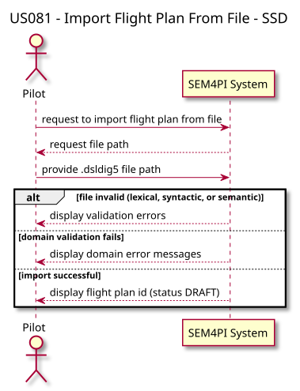
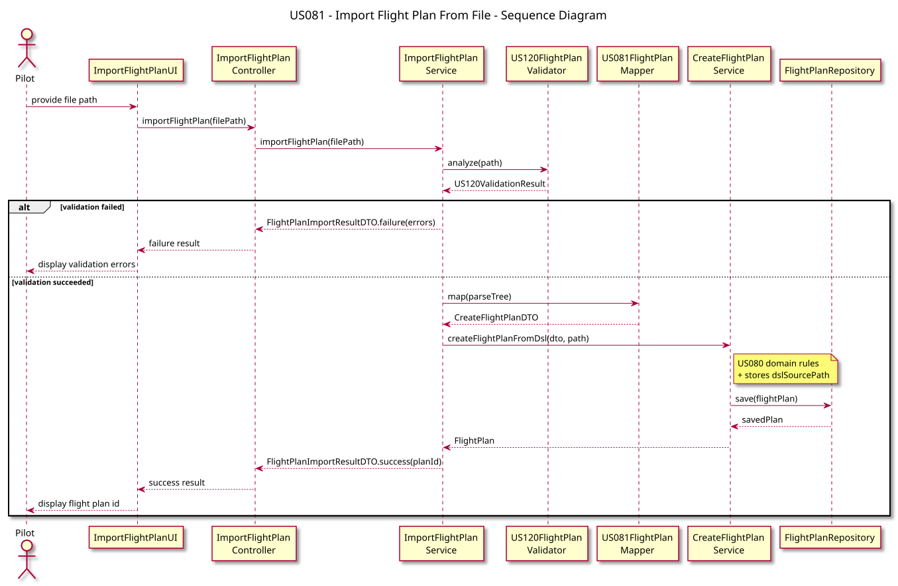

# US081 — Create a Flight Plan From a File

## 1. Requirements Engineering

### 1.1 User Story

As a **Pilot**, I want to create a valid flight plan from a file. The system must validate the file (lexical, syntactic, and semantic rules) before importing it into the domain model.

### 1.2 Acceptance Criteria

- Only `.dsldig5` files conforming to the Core Flight DSL (US120) are accepted.
- Lexical, syntactic, and semantic validation runs before any persistence attempt.
- Invalid files are rejected with clear, grouped error messages.
- Valid files are mapped to the domain model and stored as `FlightPlan` aggregates in **DRAFT** status.
- The original DSL file path is stored on the plan for later re-validation (US085).
- Domain rules from US080 still apply after DSL validation (route, pilot, aircraft, legs).

### 1.3 Dependencies

- **US120:** ANTLR4 grammar (`US120.g4`) and semantic validators.
- **US080:** `CreateFlightPlanService` and `FlightPlan` aggregate.
- **US030:** Authentication (`PILOT`, `ADMIN`).

---

## 2. Analysis

US081 sits between DSL validation and domain creation. The import pipeline is:

1. Read and validate the file with `US120FlightPlanValidator`.
2. Map the parse tree to `CreateFlightPlanDTO` via `US081FlightPlanMapper`.
3. Delegate to `CreateFlightPlanService.createFlightPlanFromDsl()`, which applies US080 business rules and stores the DSL source path.

The mapper is an ANTLR visitor over the US120 parse tree. It extracts flight id, type, aircraft registration, pilot id, route id, legs, segments, and fuel.

US121 adds a format-detection layer on top of this same pipeline (`CreateFlightPlanFromFileService`). The core import logic remains in `ImportFlightPlanService`.

---

## 3. Design

### 3.1 Architecture

```text
ImportFlightPlanUI
        │
        ▼
ImportFlightPlanController
        │
        ▼
ImportFlightPlanService
        ├── US120FlightPlanValidator   (lexical / syntactic / semantic)
        ├── US081FlightPlanMapper      (parse tree → DTO)
        └── CreateFlightPlanService    (US080 domain rules + persistence)
```

| Layer | Components |
|-------|------------|
| Presentation | `ImportFlightPlanUI`, `ImportFlightPlanAction` |
| Application | `ImportFlightPlanController`, `ImportFlightPlanService` |
| DSL | `US120.g4`, `US120FlightPlanValidator`, `US081FlightPlanMapper` |
| Domain | Reuses US080 `FlightPlan` creation |

### 3.2 Import Flow

1. User provides a file path (`.dsldig5`).
2. `US120FlightPlanValidator.analyze(path)` runs lexer, parser, semantic listener, and semantic visitor.
3. If validation fails, `FlightPlanImportResultDTO.failure(errors)` is returned — nothing is persisted.
4. If validation succeeds, `US081FlightPlanMapper.map(parseTree)` builds the DTO.
5. `CreateFlightPlanService.createFlightPlanFromDsl(dto, path)` creates the plan and stores `dslSourcePath`.
6. On success, the UI shows the generated flight plan id.

### 3.3 Grammar Reference

The grammar is defined in `src/main/antlr4/US120.g4`. A documentation copy is kept at `docs/us_081/US81.g4`.

Example structure:

```text
flight <ID> <regular|charter> {
    aircraft <REGISTRATION>;
    pilot <PILOT_ID>;
    route <ID> { (lat|lon) ... };
    leg {
        departure { <AIRPORT>, <DATE>, <TIME> };
        arrival { <AIRPORT>, <TIME> };
        segment { (lat|lon), (lat|lon), {(min,max)}, <width>, <windAngle>, <speed> };
        fuel { <quantity>, <unit> };
    };
};
```

---

## 4. Architecture Diagrams

### 4.1 System Sequence Diagram (SSD)



### 4.2 Sequence Diagram (SD)



---

## 5. Example Files

Bootstrap-compatible examples (route `TP1001`, aircraft `CS-TST`, pilot `PILOT01`):

| File | Purpose |
|------|---------|
| `docs/us_081/examples/exampleValid.dsldig5` | Valid import |
| `docs/us_081/examples/exampleInvalid.dsldig5` | Semantic/syntactic errors |
| `docs/us_120/testFiles/exemplo.dsldig5` | Reference from US120 |

---

## 6. Manual Test

1. Login as `pilot` / `Password1`.
2. Use **Flight Planning > Create flight plan from file (US121)** (wraps the US081 import pipeline with format detection), or call `ImportFlightPlanUI` directly in tests.
3. Import `docs/us_081/examples/exampleInvalid.dsldig5` — expect validation errors, no persistence.
4. Import a valid file with route `TP1001` — expect DRAFT plan created.

---

## 7. Tests

- `ImportFlightPlanServiceTest`
- `ImportFlightPlanControllerTest`
- `US081FlightPlanMapperTest`
- `US120SemanticValidationTest`

Run:

```bash
mvn test
```

---

## 8. Related Stories

- **US120:** Flight DSL specification and ANTLR validation.
- **US080:** domain model and creation rules applied after mapping.
- **US121:** format detection wrapper over this import pipeline.
- **US085:** re-validates the stored DSL and runs the C flight test.
