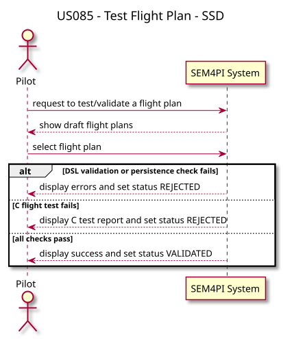
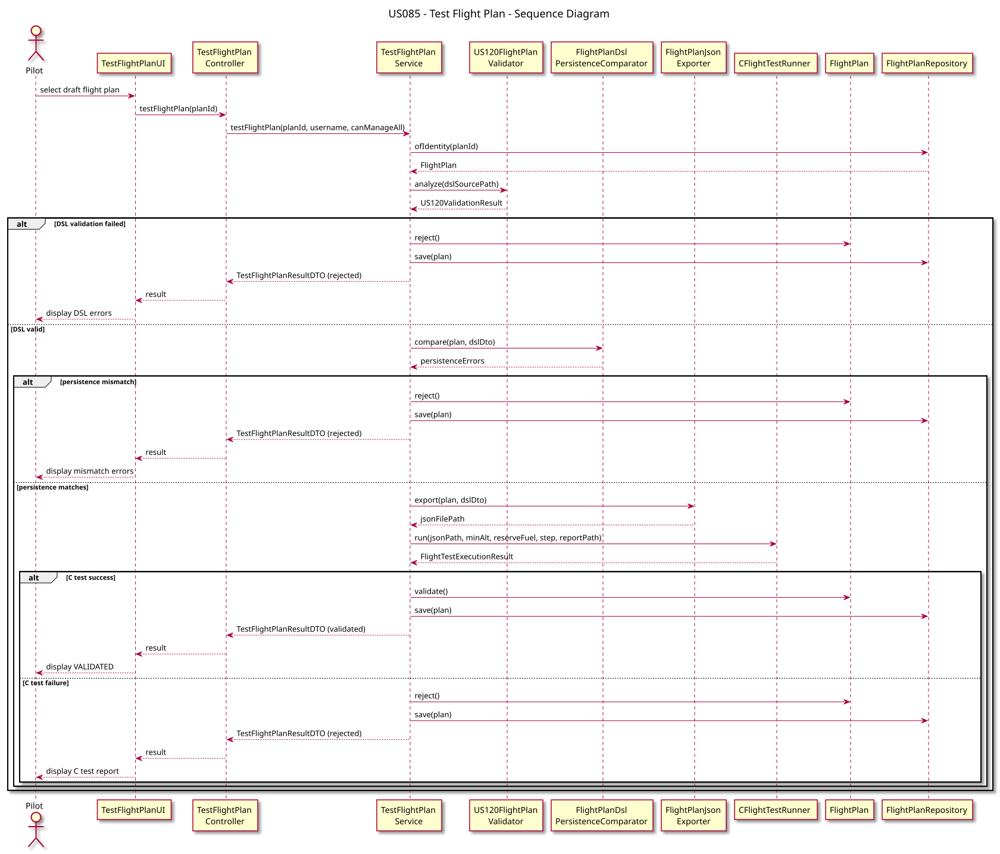

# US085 — Test / Validate Flight Plan

## 1. Requirements Engineering

### 1.1 User Story

As a **Pilot**, I want to test/validate a flight plan I have created.

### 1.2 Acceptance Criteria

- Only **DRAFT** flight plans owned by the authenticated pilot (or any plan for `ADMIN`) can be tested.
- Validation includes re-checking the associated `.dsldig5` file (US120) and comparing persisted data with the DSL.
- A **C flight test** verifies altitude and fuel requirements along the route.
- On success the flight plan status becomes **VALIDATED**; on failure **REJECTED**.
- No DSL or JSON file path is requested from the user during testing.

### 1.3 Dependencies

- **US080:** flight plan domain model (DRAFT status).
- **US081 / US121:** import pipeline that stores `dslSourcePath`.
- **US120:** DSL re-validation during testing.
- **US050:** Air Control Area minimum reserve fuel rule (destination airport).
- **SCOMP:** C component `flight_test_validator`.

---

## 2. Analysis

Testing is a multi-step orchestration in `TestFlightPlanService`:

1. **Authorization and status check** — only DRAFT plans accessible to the pilot.
2. **DSL re-validation** — reads the stored `dslSourcePath` and runs `US120FlightPlanValidator`.
3. **Persistence comparison** — `FlightPlanDslPersistenceComparator` ensures the stored aggregate matches the DSL mapping.
4. **JSON export** — `FlightPlanJsonExporter` generates `scomp/data/generated/<plan-id>.json`.
5. **C flight test** — `CFlightTestRunner` invokes `scomp/flight_test_validator` with minimum altitude, reserve fuel, and step interval.
6. **Status transition** — `plan.validate()` or `plan.reject()` based on the C test outcome.

If DSL validation or persistence comparison fails, the C test is skipped and the plan is rejected.

---

## 3. Design

### 3.1 Architecture

```text
TestFlightPlanUI
        │
        ▼
TestFlightPlanController
        │
        ▼
TestFlightPlanService
        ├── US120FlightPlanValidator
        ├── FlightPlanDslPersistenceComparator
        ├── FlightPlanJsonExporter
        ├── CFlightTestRunner → flight_test_validator (C)
        └── FlightPlanRepository
```

| Layer | Components |
|-------|------------|
| Presentation | `TestFlightPlanUI`, `TestFlightPlanAction` |
| Application | `TestFlightPlanController`, `TestFlightPlanService` |
| Infrastructure | `FlightPlanJsonExporter`, `CFlightTestRunner` |
| External | `scomp/flight_test_validator` |

### 3.2 Test Flow

1. Pilot opens **Flight Planning > Test / validate flight plan**.
2. UI lists DRAFT plans; user selects one.
3. Service re-validates the associated DSL file.
4. Service compares persisted plan with DSL mapping.
5. Service exports JSON and runs the C validator.
6. Plan status becomes **VALIDATED** or **REJECTED**; results are shown in the UI.

### 3.3 C Component

Executable: `scomp/flight_test_validator`

```bash
cd scomp && make
./flight_test_validator \
  --plan data/generated/FP-000003.json \
  --min-alt 300 \
  --min-reserve-fuel 1200 \
  --step 60 \
  --output reports/test-report.txt
```

Default parameters in Java: minimum altitude 300 m, step 60 s, reserve fuel from destination airport's Air Control Area.

---

## 4. Architecture Diagrams

### 4.1 System Sequence Diagram (SSD)



### 4.2 Sequence Diagram (SD)



---

## 5. Manual Test

1. Build C validator: `cd scomp && make`
2. Login as `pilot` / `Password1`.
3. Create or import a flight plan (US080 / US081 / US121).
4. Open **Flight Planning > Test / validate flight plan**.
5. Select the draft plan — no extra files required.
6. Verify status changes to **VALIDATED** or **REJECTED**.

---

## 6. Tests

- `TestFlightPlanServiceTest`
- `TestFlightPlanControllerTest`

Run:

```bash
mvn test
```

---

## 7. Related Stories

- **US080:** manual flight plan creation (starts in DRAFT).
- **US081 / US121:** import from DSL (stores source path required by US085).
- **US082:** adding weather data invalidates a previous test.
- **US120:** DSL validation reused during testing.
