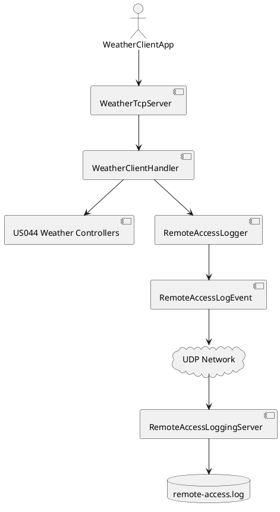
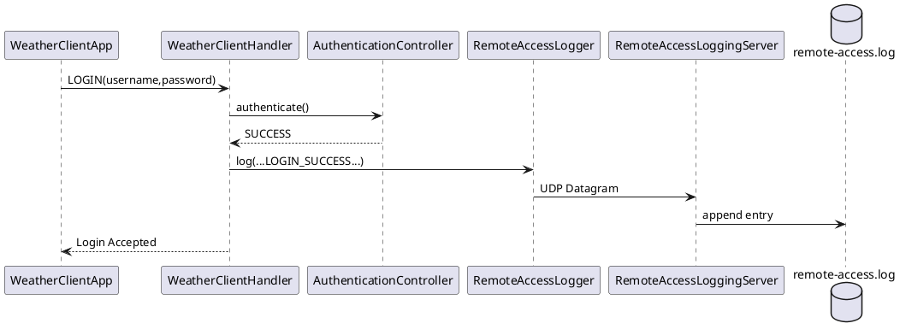
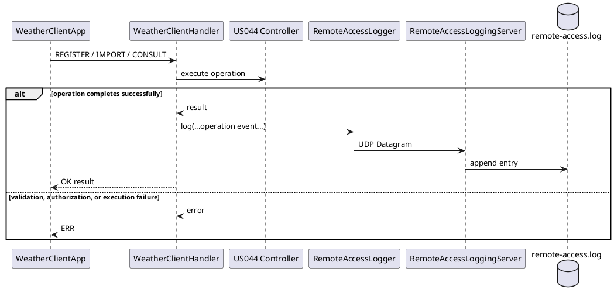
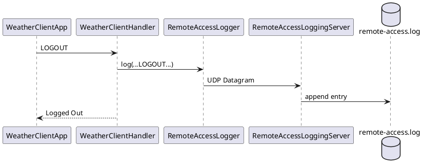

# US090 - External Logging of Remote Accesses

## 1. Objective
As Administrator, I want to have logs for every remote access to the system.

US090 implements remote access auditing by sending access and successful business-operation events to an external UDP logging service. In the current codebase, this support is integrated with US044 (Weather Person remote access) and was designed to be reusable by US078 and US086 by changing only the service identifier.

---

## 2. Requirements
Implemented requirements in the current code:

- Successful login logging
- Failed login logging
- Logout logging
- Disconnect logging
- Successful weather data registration logging
- Successful weather data import logging
- Successful weather data consultation logging

Each logged event contains:

- timestamp
- username
- client IP address
- client port
- service identifier
- event type

Current integration scope:

- Implemented and wired in US044 using service identifier `US44`.

---

## 3. Solution Overview
The implemented architecture has five main parts:

1. Weather Remote Access Server (US044)
- Class: `pt.isep.sem4pi.presentation.network.weather.WeatherTcpServer`
- Creates one `WeatherClientHandler` per TCP client and injects a reusable logger.

2. Remote Access Logger component
- Class: `pt.isep.sem4pi.infrastructure.remoteaccess.RemoteAccessLogger`
- Exposes `log(username, clientIp, clientPort, service, eventType)`.
- Formats events and sends them as UDP datagrams.

3. UDP communication
- Uses `DatagramSocket`/`DatagramPacket`.
- Host and port are configurable via system properties/env vars.

4. Remote Access Logging Server
- Class: `pt.isep.sem4pi.presentation.network.remoteaccess.RemoteAccessLoggingServer`
- Listens on UDP, receives log datagrams, and writes them to a file.

5. Log file persistence
- Received lines are appended using `Files.writeString(..., CREATE, APPEND)`.

Why UDP was chosen in this implementation:

- Lightweight and simple for fire-and-forget audit events.
- No connection handshake overhead.
- Allows the remote access flow to continue even if the logging endpoint is unavailable.

Failure isolation:

- `RemoteAccessLogger.log(...)` catches all exceptions and does not propagate errors.
- Logging failures do not stop authentication or TCP session processing.

---

## 4. Architecture



---

## 5. Main Components

### RemoteAccessEventType
Class:
- `pt.isep.sem4pi.infrastructure.remoteaccess.RemoteAccessEventType`

Purpose:
- Enumerates supported event types.

Values:
- `LOGIN_SUCCESS`
- `LOGIN_FAILED`
- `LOGOUT`
- `DISCONNECT`
- `REGISTER_WEATHER_DATA`
- `IMPORT_WEATHER_DATA`
- `CONSULT_WEATHER_DATA`

Interaction:
- Used by `WeatherClientHandler` when triggering logs.
- Serialized by `RemoteAccessLogEvent` into payload text.

### RemoteAccessLogEvent
Class:
- `pt.isep.sem4pi.infrastructure.remoteaccess.RemoteAccessLogEvent`

Purpose:
- Immutable event record containing all required fields.

Main methods:
- `toPayload()` -> builds semicolon-separated line.

Responsibilities:
- Normalizes blank/null `username`, `clientIp`, `service` to `-`.
- Applies timestamp format `yyyy-MM-dd'T'HH:mm:ss`.

Interaction:
- Instantiated by `RemoteAccessLogger` before UDP send.

### RemoteAccessLogger
Class:
- `pt.isep.sem4pi.infrastructure.remoteaccess.RemoteAccessLogger`

Purpose:
- Reusable component that sends remote access events through UDP.

Main methods:
- `log(String username, String clientIp, int clientPort, String service, RemoteAccessEventType eventType)`
- `defaultLogger()`
- `resolveHost()` / `resolvePort()`

Responsibilities:
- Resolve destination host/port from:
  - System properties: `remote.access.logging.host`, `remote.access.logging.port`
  - Environment: `REMOTE_ACCESS_LOGGING_HOST`, `REMOTE_ACCESS_LOGGING_PORT`
  - Defaults: `127.0.0.1`, `9000`
- Build datagram payload and send via `DatagramSocket`.
- Catch exceptions (best effort logging).

Interaction:
- Injected into `WeatherTcpServer` and passed to each `WeatherClientHandler`.

### WeatherTcpServer
Class:
- `pt.isep.sem4pi.presentation.network.weather.WeatherTcpServer`

Purpose:
- Hosts the US044 TCP server and wires the logging component.

Main methods:
- `start()`
- `stop()`

Responsibilities for US090:
- Holds `RemoteAccessLogger` and `serviceIdentifier`.
- Creates `WeatherClientHandler(client, remoteAccessLogger, serviceIdentifier)`.
- Default constructor uses service identifier `US44`.

Interaction:
- Bridge between server accept loop and per-connection logging-capable handler.

### WeatherClientHandler
Class:
- `pt.isep.sem4pi.presentation.network.weather.WeatherClientHandler`

Purpose:
- Handles one US044 TCP client session.

Main logging trigger points:
- `handleLogin(...)`
  - `LOGIN_FAILED` for malformed login command and invalid credentials.
  - `LOGIN_SUCCESS` for authenticated login.
- `dispatch(...)` on `CMD_LOGOUT`
  - `LOGOUT` before session state reset.
- `handleRegister(...)`
  - `REGISTER_WEATHER_DATA` after `RegisterWeatherController.registerWeather(...)` completes.
- `executeImport(...)`
  - `IMPORT_WEATHER_DATA` after `ImportWeatherDataController.importWeatherData(...)` returns a result.
  - Both `IMPORT` and chunked `IMPORT_BEGIN` use this same completion point.
- `handleConsult(...)`
  - `CONSULT_WEATHER_DATA` after `ConsultWeatherDataController.consultByAreaAndDate(...)` returns.
  - An empty result is still a successfully completed consultation.
- `run()` `finally`
  - `DISCONNECT` on connection end (normal or unexpected).

Responsibilities for event data:
- Extracts client IP and port from socket remote address.
- Uses current username when available, otherwise `-`.
- Uses injected service identifier (`US44` in current integration).

### RemoteAccessLoggingServer
Class:
- `pt.isep.sem4pi.presentation.network.remoteaccess.RemoteAccessLoggingServer`

Purpose:
- External UDP receiver that persists incoming log lines.

Main methods:
- `main(String[] args)`
- `start()`
- `stop()`

Responsibilities:
- Resolve listen port and log file path from args/system/env.
- Receive UDP datagrams in a loop.
- Append each received line to a log file.

Configuration resolution:
- Port:
  - Arg[0]
  - Property: `remote.access.logging.server.port`
  - Env: `REMOTE_ACCESS_LOGGING_SERVER_PORT`
  - Default: `9000`
- Log file:
  - Arg[1]
  - Property: `remote.access.logging.server.logFile`
  - Env: `REMOTE_ACCESS_LOGGING_SERVER_LOGFILE`
  - Default: `remote-access.log`

### Launcher Scripts
Scripts:
- `run-remote-access-logging-server.sh`
- `run-remote-access-logging-server.bat`

Purpose:
- Compile project, build classpath, and start `RemoteAccessLoggingServer`.

---

## 6. Event Flow

### LOGIN_SUCCESS
When it occurs:
- In `WeatherClientHandler.handleLogin(...)`, after authentication succeeds.

Information sent:
- timestamp
- authenticated username
- client IP
- client port
- service identifier (`US44`)
- event type `LOGIN_SUCCESS`

### LOGIN_FAILED
When it occurs:
- In `WeatherClientHandler.handleLogin(...)` when:
  - Login command is malformed (missing arguments)
  - Authentication result is not success

Information sent:
- timestamp
- provided username when available, otherwise `-`
- client IP
- client port
- service identifier (`US44`)
- event type `LOGIN_FAILED`

### LOGOUT
When it occurs:
- In `WeatherClientHandler.dispatch(...)` when processing `LOGOUT`, before clearing session fields.

Information sent:
- timestamp
- current logged user (or `-`)
- client IP
- client port
- service identifier (`US44`)
- event type `LOGOUT`

### DISCONNECT
When it occurs:
- In `WeatherClientHandler.run()` `finally` block for any connection termination path.

Information sent:
- timestamp
- current username if present, otherwise `-`
- client IP
- client port
- service identifier (`US44`)
- event type `DISCONNECT`

### REGISTER_WEATHER_DATA
When it occurs:
- In `WeatherClientHandler.handleRegister(...)`, after the registration controller completes successfully.

Not logged:
- Malformed commands, invalid date/time values, authorization failures, or controller exceptions.

### IMPORT_WEATHER_DATA
When it occurs:
- In `WeatherClientHandler.executeImport(...)`, after the import controller returns its result.
- The event is shared by legacy `IMPORT` and chunked `IMPORT_BEGIN`, because these are transport alternatives for the same business operation.

Not logged:
- Import initialization, individual chunks, invalid Base64 payloads, authorization failures, or controller exceptions.
- Record-level rejections reported in a completed import result do not prevent the operation from being audited as completed.

### CONSULT_WEATHER_DATA
When it occurs:
- In `WeatherClientHandler.handleConsult(...)`, after the consultation controller returns.
- A valid consultation returning no matching records is logged because the operation completed successfully.

Not logged:
- Malformed commands, invalid dates, authorization failures, or controller exceptions.

---

## 7. Sequence Diagram

Successful login:



Successful business operation:



Logout:



---

## 8. Log Format
Implemented payload format:

```text
2026-06-10T12:20:28;admin;127.0.0.1;50758;US44;LOGIN_SUCCESS
```

Field description (in order):

1. `timestamp`
- Format: `yyyy-MM-dd'T'HH:mm:ss`

2. `username`
- Authenticated username, attempted username, or `-` when unavailable

3. `clientIp`
- Remote client IP from socket

4. `clientPort`
- Remote client TCP port

5. `service`
- Service identifier (currently `US44`)

6. `eventType`
- Access event: `LOGIN_SUCCESS`, `LOGIN_FAILED`, `LOGOUT`, or `DISCONNECT`
- Successful US044 operation: `REGISTER_WEATHER_DATA`, `IMPORT_WEATHER_DATA`, or `CONSULT_WEATHER_DATA`

---

## 9. Error Handling
Implemented protections:

- Logging server unavailable:
  - `RemoteAccessLogger.log(...)` catches exceptions and returns.
  - Remote access flow continues.

- UDP packet loss:
  - UDP is connectionless; delivery is best-effort.
  - Application does not block/retry, preserving remote access responsiveness.

- Invalid user or malformed login:
  - Login failure is still logged (`LOGIN_FAILED`).
  - User receives protocol error and session continues.

- Invalid or failed business operation:
  - No operation event is sent unless the corresponding controller completes.
  - Menu/help commands, import setup, and import chunks are not audited as business operations.

- Connection termination:
  - `DISCONNECT` is triggered in `finally`, covering normal close and unexpected IO termination.

Result:
- Audit logging is non-intrusive; failures in external logging do not crash or stop US044 processing.

---

## 10. Manual Validation
Validation scenario documented for US090 acceptance:

Environment:

- AntiX Linux
- Java
- Maven

Commands executed:

```bash
mvn clean compile
```

```bash
./run-remote-access-logging-server.sh
```

```bash
./run-weather-server.sh
```

```bash
./run-client.sh 127.0.0.1 8044
```

Validation scenarios:

1. Successful login
2. Logout
3. Failed login
4. Disconnect
5. Successful weather data registration
6. Successful weather data import
7. Successful weather data consultation
8. Invalid operation input does not create an operation event

Representative log entries:

```text
2026-06-10T12:20:28;admin;127.0.0.1;50758;US44;LOGIN_SUCCESS
2026-06-10T12:22:32;admin;127.0.0.1;50758;US44;LOGOUT
2026-06-10T12:23:20;-;127.0.0.1;50758;US44;DISCONNECT
2026-06-10T12:40:16;admin;127.0.0.1;59166;US44;LOGIN_FAILED
2026-06-11T10:15:30;weather;127.0.0.1;51522;US44;REGISTER_WEATHER_DATA
2026-06-11T10:17:04;weather;127.0.0.1;51522;US44;IMPORT_WEATHER_DATA
2026-06-11T10:18:12;weather;127.0.0.1;51522;US44;CONSULT_WEATHER_DATA
```

What these scenarios validate:

- All existing access events remain present and unchanged.
- The three real US044 business operations are audited only after successful completion.
- Every line contains timestamp, username, client IP, client port, service identifier, and event type.
- Service identifier is `US44`, matching the implemented integration target.

Additional repository-state note:

- In the current repository baseline, full compile can fail due unrelated pre-existing issues in other modules.
- US090-specific classes and tests are implemented and syntactically valid in the inspected codebase.

---

## 11. Current Scope and Future Extension
US090 was designed to support all remote access services identified in the requirements:

- US044 – Weather Person remote access
- US078 – Air Transport Company Collaborator remote access
- US086 – Pilot remote access

At the time of implementation, only US044 was available and operational. Therefore, the logging infrastructure was integrated and validated exclusively with US044.

The solution was intentionally designed to be reusable. The logging mechanism receives the service identifier as part of the event information, allowing future integration with US078 and US086 without requiring changes to the Remote Access Logging Server.

Since US078 and US086 were not yet implemented during the development of US090, no integration or validation could be performed for those services.
