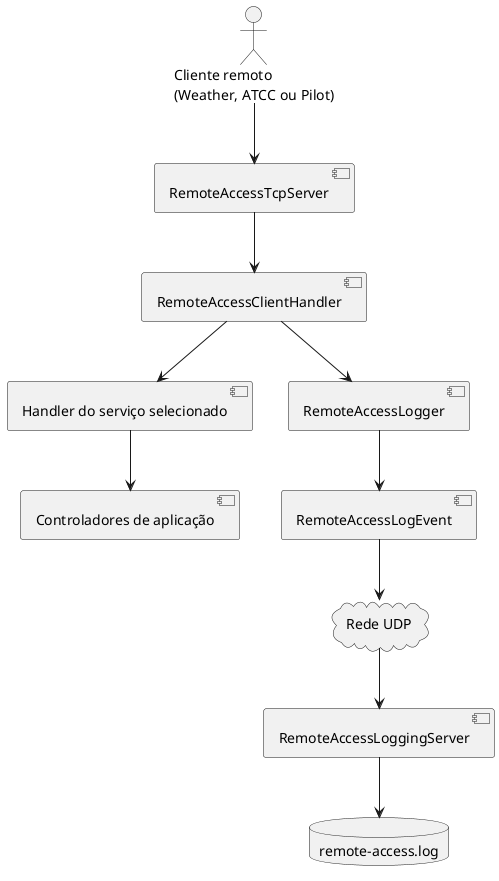
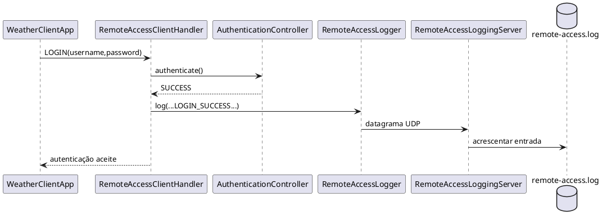
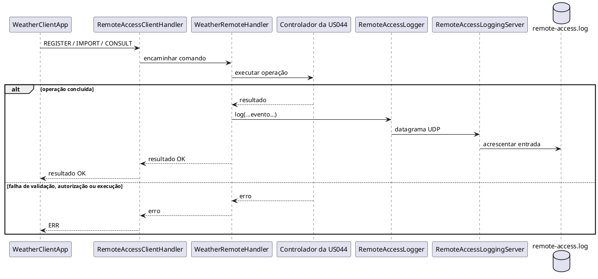

# US090 - Registo Externo dos Acessos Remotos

## 1. Objetivo

Enquanto Administrador, pretendo dispor de registos de todos os acessos
remotos ao sistema.

A US090 implementa a auditoria dos acessos remotos através do envio de eventos
de acesso e de operações de negócio concluídas para um serviço externo de
registo UDP. A integração abrange os três serviços remotos: US044
(Responsável Meteorológico), US078 (Colaborador de Companhia de Transporte
Aéreo) e US086 (Piloto).

## 2. Requisitos

São registados os seguintes eventos:

- autenticação bem-sucedida;
- autenticação falhada;
- fim de sessão;
- interrupção da ligação;
- registo de dados meteorológicos concluído;
- importação de dados meteorológicos concluída;
- consulta de dados meteorológicos concluída.

Cada evento contém:

- marca temporal;
- nome de utilizador;
- endereço IP e porto do cliente;
- identificador do serviço;
- tipo de evento.

Cada evento usa o identificador do serviço selecionado: `US44`, `US78` ou
`US86`.

## 3. Visão Geral da Solução

A arquitetura é composta por cinco partes:

1. **Servidor unificado de acesso remoto**
   - `pt.isep.sem4pi.presentation.network.remoteaccess.RemoteAccessTcpServer`
   - cria um `RemoteAccessClientHandler` por cliente TCP;
   - encaminha os pedidos para `WeatherRemoteHandler`,
     `AirTransportCompanyRemoteHandler` ou `PilotRemoteHandler`.
2. **Componente de registo**
   - `pt.isep.sem4pi.infrastructure.remoteaccess.RemoteAccessLogger`
   - disponibiliza
     `log(username, clientIp, clientPort, service, eventType)`.
3. **Comunicação UDP**
   - usa `DatagramSocket` e `DatagramPacket`;
   - o endereço e o porto são configuráveis.
4. **Servidor externo de registos**
   - `pt.isep.sem4pi.presentation.network.remoteaccess.RemoteAccessLoggingServer`
   - recebe datagramas UDP e escreve-os num ficheiro.
5. **Persistência em ficheiro**
   - as linhas são acrescentadas através de
     `Files.writeString(..., CREATE, APPEND)`.

Foi escolhido UDP por ser leve e adequado ao envio de eventos de auditoria sem
confirmação. A indisponibilidade do servidor de registos não deve interromper
o acesso remoto. Por esse motivo, `RemoteAccessLogger.log(...)` captura as
exceções e não as propaga.

## 4. Arquitetura



## 5. Componentes Principais

### `RemoteAccessEventType`

Enumera os tipos de evento suportados:

- `LOGIN_SUCCESS`;
- `LOGIN_FAILED`;
- `LOGOUT`;
- `DISCONNECT`;
- `REGISTER_WEATHER_DATA`;
- `IMPORT_WEATHER_DATA`;
- `CONSULT_WEATHER_DATA`.

É usado pelo `RemoteAccessClientHandler` e pelos handlers dos serviços, sendo
serializado por
`RemoteAccessLogEvent`.

### `RemoteAccessLogEvent`

Representa um evento imutável com todos os campos obrigatórios.

O método `toPayload()` produz uma linha separada por ponto e vírgula. Os
valores nulos ou vazios de `username`, `clientIp` e `service` são normalizados
para `-`. A marca temporal segue o formato `yyyy-MM-dd'T'HH:mm:ss`.

### `RemoteAccessLogger`

Envia eventos através de UDP. O destino é resolvido pela seguinte ordem:

- propriedades `remote.access.logging.host` e `remote.access.logging.port`;
- variáveis `REMOTE_ACCESS_LOGGING_HOST` e `REMOTE_ACCESS_LOGGING_PORT`;
- valores predefinidos `127.0.0.1` e `9000`.

O componente é injetado no `RemoteAccessTcpServer` e passado a cada
`RemoteAccessClientHandler`.

### `RemoteAccessTcpServer`

Disponibiliza o servidor TCP comum às US044, US078 e US086 e faz a composição
do componente de registo.

### `RemoteAccessClientHandler`

Trata uma sessão TCP, aplica autenticação e autorização, gere a seleção do
serviço e gera os eventos de sessão:

- autenticação: `LOGIN_SUCCESS` ou `LOGIN_FAILED`;
- fim de sessão: `LOGOUT`;
- bloco `finally` de `run()`: `DISCONNECT`.

O endereço e o porto são obtidos da ligação. É usado o utilizador atual quando
disponível, ou `-` em caso contrário. O identificador registado corresponde ao
serviço selecionado (`US44`, `US78` ou `US86`).

Os handlers específicos registam as operações de negócio concluídas. Por
exemplo, `WeatherRemoteHandler` produz `REGISTER_WEATHER_DATA`,
`IMPORT_WEATHER_DATA` e `CONSULT_WEATHER_DATA`.

### `RemoteAccessLoggingServer`

Recebe datagramas UDP e acrescenta cada linha ao ficheiro de registo.

Configuração do porto:

1. primeiro argumento;
2. propriedade `remote.access.logging.server.port`;
3. variável `REMOTE_ACCESS_LOGGING_SERVER_PORT`;
4. valor predefinido `9000`.

Configuração do ficheiro:

1. segundo argumento;
2. propriedade `remote.access.logging.server.logFile`;
3. variável `REMOTE_ACCESS_LOGGING_SERVER_LOGFILE`;
4. valor predefinido `remote-access.log`.

### Scripts de Arranque

- `run-remote-access-logging-server.sh`;
- `run-remote-access-logging-server.bat`.

Os scripts compilam o projeto, constroem o classpath e iniciam o servidor.

## 6. Fluxo dos Eventos

### `LOGIN_SUCCESS`

É enviado depois de a autenticação ser concluída com sucesso. Inclui o
utilizador autenticado, o endereço do cliente e o identificador do serviço
remoto aplicável.

### `LOGIN_FAILED`

É enviado quando o comando está incompleto ou as credenciais são inválidas.
Inclui o utilizador introduzido, quando disponível.

### `LOGOUT`

É enviado antes de os dados da sessão serem limpos.

### `DISCONNECT`

É enviado no bloco `finally`, cobrindo fechos normais e interrupções
inesperadas.

### Eventos de Operações Meteorológicas

Os eventos `REGISTER_WEATHER_DATA`, `IMPORT_WEATHER_DATA` e
`CONSULT_WEATHER_DATA` só são enviados depois de o respetivo controlador
terminar e a resposta ser produzida.

Não são registados como operações concluídas:

- comandos malformados;
- datas ou valores inválidos;
- falhas de autorização;
- exceções dos controladores;
- inicialização ou blocos individuais de uma importação;
- cargas Base64 inválidas.

Uma consulta válida sem resultados continua a ser registada como concluída. As
rejeições de linhas individuais numa importação concluída também não impedem o
registo da operação.

## 7. Diagramas de Sequência

Autenticação bem-sucedida:



Operação de negócio:



## 8. Formato do Registo

```text
2026-06-10T12:20:28;admin;127.0.0.1;50758;US44;LOGIN_SUCCESS
```

Campos:

1. `timestamp`, no formato `yyyy-MM-dd'T'HH:mm:ss`;
2. `username`, ou `-` quando indisponível;
3. `clientIp`;
4. `clientPort`;
5. `service`;
6. `eventType`.

## 9. Tratamento de Erros

- A indisponibilidade do servidor de registos não interrompe a operação.
- O UDP funciona em regime de melhor esforço, sem bloqueios ou novas
  tentativas.
- As autenticações inválidas são registadas como `LOGIN_FAILED`.
- Só são registadas operações de negócio concluídas.
- `DISCONNECT` é gerado tanto em fechos normais como em erros de E/S.

O resultado é uma auditoria não intrusiva: uma falha do serviço externo não
impede o funcionamento das US044, US078 e US086.

## 10. Validação Manual

Comandos:

```bash
mvn clean compile
./run-remote-access-logging-server.sh
./run-main-server.sh
./run-client.sh 127.0.0.1 8044
./run-atcc-client.sh 127.0.0.1 8044
./run-pilot-client.sh 127.0.0.1 8044
```

Cenários validados:

1. autenticação bem-sucedida;
2. fim de sessão;
3. autenticação falhada;
4. interrupção da ligação;
5. registo de dados meteorológicos;
6. importação de dados meteorológicos;
7. consulta de dados meteorológicos;
8. entrada inválida sem criação de evento de operação.

Exemplos:

```text
2026-06-10T12:20:28;admin;127.0.0.1;50758;US44;LOGIN_SUCCESS
2026-06-10T12:22:32;admin;127.0.0.1;50758;US44;LOGOUT
2026-06-10T12:23:20;-;127.0.0.1;50758;US44;DISCONNECT
2026-06-10T12:40:16;admin;127.0.0.1;59166;US44;LOGIN_FAILED
2026-06-11T10:15:30;weather;127.0.0.1;51522;US44;REGISTER_WEATHER_DATA
2026-06-11T10:17:04;weather;127.0.0.1;51522;US44;IMPORT_WEATHER_DATA
2026-06-11T10:18:12;weather;127.0.0.1;51522;US44;CONSULT_WEATHER_DATA
```

## 11. Âmbito Atual

A infraestrutura está integrada com todos os serviços remotos previstos para
uma equipa de cinco elementos:

- US044 - Responsável Meteorológico;
- US078 - Colaborador de Companhia de Transporte Aéreo;
- US086 - Piloto.

Os três serviços partilham o servidor TCP, mantendo clientes e handlers
específicos. Os eventos são enviados ao mesmo servidor externo de registos com
o identificador `US44`, `US78` ou `US86`, conforme o serviço utilizado.
