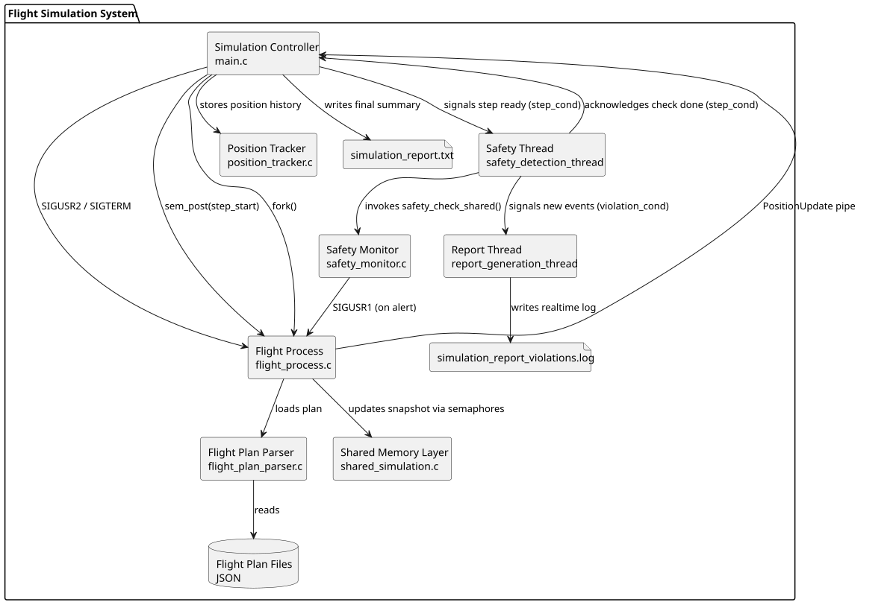

# SCOMP - Sprint 3

Simulador concorrente de voos desenvolvido em C com APIs POSIX. O processo
principal coordena o tempo da simulacao, cria um processo por voo, recolhe as
posicoes, mantem o historico, deteta violacoes e produz os relatorios.

## Diagrama de componentes



O ficheiro editavel encontra-se em
[`ComponentsDiagram.puml`](ComponentsDiagram.puml).

O sistema tem um processo principal, dois workers implementados como threads e
um processo filho por voo. Os filhos enviam posicoes por pipes e publicam o
estado atual em memoria partilhada. O pai controla cada timestep através dos
semaforos `step_start[]`; depois de receber os updates esperados, acorda a
thread de seguranca e espera pela sua confirmacao antes de libertar o passo
seguinte.

## Estrutura principal

| Ficheiro | Responsabilidade |
|---|---|
| `src/main.c` | Argumentos, processos, pipes, `poll()`, relogio global e relatorio final |
| `src/flight_process.c` | Execucao de um voo, sinais, movimento e publicacao de updates |
| `src/flight_plan_parser.c` | Leitura dos planos JSON |
| `src/position_tracker.c` | Posicao atual e historico de cada voo |
| `src/shared_simulation.c` | Memoria partilhada e sincronizacao entre processos |
| `src/safety_monitor.c` | Violacoes de altitude e separacao |
| `src/simulation_threads.c` | Threads de seguranca e relatorio em tempo real |

## Abordagem por User Story

| US | Abordagem seguida | Estado |
|---|---|---|
| US100 | Um processo por voo com `fork()`. Cada filho carrega o plano, simula o movimento e comunica com o pai. O arranque usa `SIGUSR2`. | Herdada do sprint anterior |
| US101 | Cada filho envia `PositionUpdate` por pipe. O pai usa `poll()` e guarda a posicao atual e o historico no `PositionTracker`. | Herdada do sprint anterior |
| US102 | Sao verificadas altitude minima e separacao horizontal/vertical. As ocorrencias ficam no `SafetyLog` e os voos envolvidos recebem `SIGUSR1`. | Herdada do sprint anterior |
| US103 | O pai funciona como relogio global e apenas processa um novo timestep depois dos updates esperados no passo atual. | Herdada do sprint anterior |
| US104 | Nao existe uma US104 atribuida ao modulo SCOMP neste incremento. | Nao aplicavel |
| US105 | O estado atual dos voos e publicado em memoria partilhada POSIX, protegido por mecanismos process-shared. | Implementada |
| US106 | O pai cria uma thread de seguranca e uma thread de relatorio, coordenadas por mutexes e condition variables locais. | Implementada |
| US107 | A thread de seguranca sinaliza `violation_cond`; a thread de relatorio consome os novos eventos e escreve-os em tempo real. | Implementada |
| US108 | Cada filho bloqueia em `sem_wait(step_start[i])` e o pai liberta o passo seguinte com `sem_post()`. | Implementada |
| US109 | A implementacao e a documentacao existentes foram desenvolvidas no sprint anterior. Nao houve implementacao desta US no Sprint 3. | Nao realizada no Sprint 3 |
| US110 | Nao foi implementada neste sprint. | Nao implementada |

## Estado da implementacao

Foi implementada com sucesso a execucao concorrente de varios voos, comunicacao
por pipes, sinais POSIX, memoria partilhada, semaforos, threads especializadas,
sincronizacao passo a passo e detecao de violacoes correspondentes as
US105-US108.

A US109 presente no repositorio pertence ao sprint anterior e nao foi
desenvolvida no Sprint 3. A US110, nao foi implementada.

## Compilacao, execucao e testes

```bash
cd scomp
make

./flight_simulator \
  --area 39 43 -9 -3 \
  --start 0 --end 3600 --step 60 \
  --weather clear \
  --safety-min-sep 3 --safety-min-alt 300 \
  --violation-threshold 10 --perf-max-flights 10 \
  --flight data/Flight_Plan_v0a.json \
  --output simulation_report.txt

make test
```

Os testes cobrem tracking, seguranca, memoria partilhada, sincronizacao por
semaforos, coordenacao das threads e cenarios completos com um ou varios voos,
threshold de violacoes e argumentos invalidos.

## Autoavaliacao da contribuicao

| Elemento | Contribuicao |
|---|---:|
| Joao Sousa | 0% |
| Goncalo Pinto | 25% |
| Guilherme Tavares | 25% |
| Mariana Gabriel | 25% |
| Pedro Soares | 25% |
| **Total** | **100%** |
