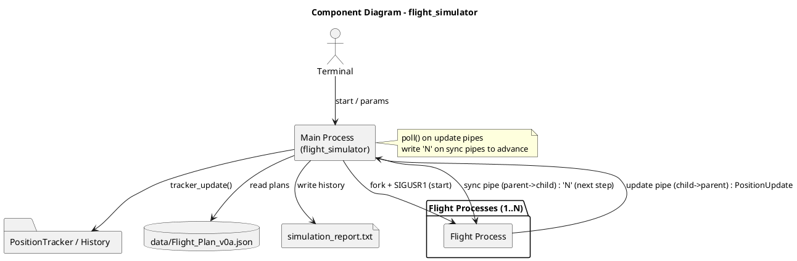

# SCOMP – Sprint 3

## Component Diagram



## User Stories Implementadas

### US100 – Simulação Base de Voos

#### Abordagem Seguida

A solução foi implementada em C utilizando mecanismos POSIX de gestão de processos e comunicação interprocessos.

O processo principal:
- valida os parâmetros da simulação;
- cria um pipe e um processo filho por cada voo usando `fork()`;
- inicia todas as simulações através de `SIGUSR1`;
- recebe atualizações de posição dos voos usando `poll()`;
- guarda o histórico recebido em memória;
- gera um relatório final da simulação.

Cada processo filho:
- lê o ficheiro do plano de voo;
- espera pelo sinal de início;
- simula o percurso segmento a segmento;
- calcula posições intermédias através de interpolação linear;
- envia atualizações para o processo principal através do pipe.

A comunicação entre processos é feita através de estruturas binárias (`struct PositionUpdate`) em vez de mensagens de texto.

#### Principais Decisões Técnicas

- Utilização de `fork()` para criar um processo independente por avião.
- Utilização de pipes POSIX para comunicação unidirecional entre processos.
- Utilização de `poll()` para monitorizar múltiplos pipes sem bloqueios.
- Utilização de sinais UNIX (`SIGUSR1`, `SIGTERM`, `SIGINT`) para controlo dos processos.
- Utilização de tempo lógico de simulação em vez de tempo real.
- Implementação de um parser simples adaptado ao formato fornecido dos planos de voo.

#### Estrutura Principal do Código

- `main.c`
  - controlo principal da simulação;
  - validação de parâmetros;
  - criação de processos;
  - gestão da comunicação;
  - geração do relatório final.

- `flight_process.c`
  - lógica de execução dos voos;
  - tratamento de sinais;
  - interpolação das posições;
  - envio de atualizações.

- `flight_plan_parser.c`
  - leitura e parsing dos ficheiros de plano de voo.

- `simulation.h`
  - estruturas partilhadas;
  - constantes;
  - declarações de funções.

#### Implementado com Sucesso

- Arquitetura com um processo por voo;
- Comunicação entre processos através de pipes;
- Sincronização com sinais;
- Execução concorrente de múltiplos voos;
- Simulação baseada em tempo lógico;
- Histórico de posições;
- Geração de relatório final;
- Alocação dinâmica do histórico;
- Validação dos parâmetros da simulação.

#### Não Implementado

- Física real de voo;
- Simulação de vento ou combustível;
- Deteção de colisões;
- Esperas em tempo real;
- Parser JSON genérico;
- Comunicação através de memória partilhada;
- Simulação baseada em threads.

#### Limitações Conhecidas

- O parser apenas suporta a estrutura dos ficheiros fornecidos.
- O movimento dos aviões é simplificado através de interpolação linear.
- A simulação utiliza apenas tempo lógico.
- `poll()` é suficiente para a escala atual, mas poderia necessitar de otimizações para um número muito elevado de voos.

---

## Compilação e Execução

### Compilar

```bash
make
```

## Executar

```bash
make run
```

Ou manualmente:

```bash
./flight_simulator --area 39 43 -9 -3 --start 0 --end 3600 --step 60 --weather clear --safety-min-sep 3 --safety-min-alt 300 --perf-max-flights 10 --flight data/Flight_Plan_v0a.json
```

Sem --start (usa DepartureTime do plano):
```bash
./flight_simulator --area 39 43 -9 -3 --end 3600 --step 60 --weather clear --safety-min-sep 3 --safety-min-alt 300 --perf-max-flights 10 --flight data/Flight_Plan_v0a.json
```

## Parâmetros

```bash
--area <minLat> <maxLat> <minLon> <maxLon>
--start <segundos>   (opcional se existir DepartureTime no plano)
--end <segundos>     (se --start for omitido, é tratado como duração)
--step <segundos>
--weather <clear|rain|storm|fog>
--safety-min-sep <nm>
--safety-min-alt <m>
--perf-max-flights <n>
--flight <ficheiro>
```

É possível indicar vários `--flight`, sendo criado um processo para cada ficheiro (limitado por `--perf-max-flights`).

### Limpar

```bash
make clean
```

---

## Output

A simulação gera:
- atualizações no terminal durante a execução;
- um ficheiro `simulation_report.txt` contendo:
  - informação dos voos;
  - número de updates recebidos;
  - posições ao longo do tempo;
  - estado final de cada voo.

---

### US101 - Capture and process flight movements

## 1. Analysis

### User Story

As a simulation process, I want to receive movement commands from flight processes so that I can track aircraft positions over time.

### Acceptance Criteria Addressed

1. Each flight process sends position updates to the main process via pipe.
2. The main process tracks the current position of each aircraft.
3. The system stores past positions to anticipate and detect potential safety violations.

## 2. Design

### Main Process

Added responsibilities compared to US100:

- initialize the `PositionTracker` before launching flight processes;
- call `tracker_update` for each `PositionUpdate` received via pipe;
- provide the complete position history to the violation detection module (US102);
- print the tracker summary at the end of the simulation;
- destroy the tracker and free memory before terminating.

### Tracking Module (`position_tracker.c`)

Responsibilities:

- maintain a table of entries, one per active flight;
- create a flight entry on the first received message;
- update the current position and most recent time step for each update;
- add each position to the dynamic history buffer of the corresponding entry;
- expose the current position of any flight by `flight_id` for external query.

## 3. Main Structures

- `TrackPoint`: an instant in a flight's history — time step, position and status.
- `TrackEntry`: complete state of a tracked flight — current position, latest time step, status and dynamic buffer of `TrackPoint`.
- `PositionTracker`: table with up to `MAX_TRACKED_FLIGHTS` entries, maintained by the main process.

## 4. Implementation Decisions

- The history buffer of each `TrackEntry` grows by duplication, guaranteeing amortized O(1) cost per insertion and avoiding frequent reallocations.
- Searching for entries by `flight_id` is linear over the number of active flights, which is sufficient given the `MAX_TRACKED_FLIGHTS` limit.
- The module is isolated in `position_tracker.c` to facilitate independent replacement or extension in the following US.

## 5. Assumed Limitations

This implementation does not handle conflict detection between aircraft, as this belongs to US102. The history stored in `TrackEntry` was designed to be directly consumed by that module. Global synchronization by time step belongs to US103.

---

### US103 - Synchronized flight simulation

## Objetivo

Implementação em C da US103. O componente sincroniza a simulação de múltiplos voos através de processos, pipes e sinais UNIX, garantindo que todos os voos avançam de forma coordenada por time steps.

Cada processo filho executa um voo e envia uma atualização de posição ao processo principal. O processo principal apenas permite o avanço para o próximo passo depois de receber os updates de todos os voos ativos.

## Relação com os critérios de aceitação

- Implementado em C.
- Usa `fork()` para criar um processo por voo.
- Usa `pipe()` para comunicação entre cada processo de voo e o processo principal.
- Usa sinais:
  - `SIGUSR1` inicia a execução sincronizada dos voos.
  - sincronização por pipe: o processo principal escreve o caractere `'N'` no `sync_pipe` para autorizar cada filho a avançar ao próximo time step (implementação por pipe usada no código; o uso de `SIGUSR2` encontra-se comentado).
  - `SIGTERM`/`SIGINT` pedem terminação limpa.
- Cada processo de voo executa o seu plano de voo e envia uma atualização por ciclo.
- O processo principal mantém histórico de posições por voo numa estrutura dinâmica (`HistoryEntry`).
- O processo principal sincroniza todos os voos antes de avançar a simulação.
- Os parâmetros obrigatórios são validados antes da execução, incluindo weather, safety thresholds e performance settings.

## Funcionamento da sincronização

Fluxo simplificado da simulação:

```text
Processo principal cria os processos filhos
↓
SIGUSR1 inicia todos os voos
↓
Cada voo envia um PositionUpdate
↓
Cada voo fica bloqueado à espera de um comando no `sync_pipe` (leitura de um `char`)
↓
O processo principal recebe os updates de todos os voos
↓
O processo principal escreve `'N'` no `sync_pipe` de cada filho para autorizar o próximo time step
↓
Todos os voos avançam para o próximo time step
````

A sincronização é feita utilizando `poll()` no processo principal e `pause()` nos processos filhos.

## Dados usados

O ficheiro `data/Flight_Plan_v0a.json` foi incluído como exemplo. O parser é simples e foi feito para suportar o formato fornecido: lê `ID`, `Segments`, `Mode`, `Start`, `End`, `Latitude`, `Longitude` e altitude em metros.

## Compilar

```bash
make
```

## Executar exemplo

```bash
make run
```

Ou manualmente:

```bash
./flight_simulator --area 39 43 -9 -3 --start 0 --end 3600 --step 60 --weather clear --safety-min-sep 3 --safety-min-alt 300 --perf-max-flights 10 --flight data/Flight_Plan_v0a.json
```

Sem `--start` (usa `DepartureTime` do plano):

```bash
./flight_simulator --area 39 43 -9 -3 --end 3600 --step 60 --weather clear --safety-min-sep 3 --safety-min-alt 300 --perf-max-flights 10 --flight data/Flight_Plan_v0a.json
```

## Parâmetros

```bash
--area <minLat> <maxLat> <minLon> <maxLon>
--start <segundos>   (opcional se existir DepartureTime no plano)
--end <segundos>     (se --start for omitido, é tratado como duração)
--step <segundos>
--weather <clear|rain|storm|fog>
--safety-min-sep <nm>
--safety-min-alt <m>
--perf-max-flights <n>
--flight <ficheiro>
```

É possível indicar vários `--flight`, sendo criado um processo para cada ficheiro (limitado por `--perf-max-flights`).

## Output

Durante a execução, o processo principal imprime as posições recebidas por step sincronizado.

No fim, é criado o ficheiro:

```text
simulation_report.txt
```

com o histórico completo de posições por voo.

## Nota de integração

Esta implementação foca a sincronização temporal da simulação da US103. A deteção de conflitos entre aeronaves e alterações automáticas de voo pertence à US102.

```

---

## Auto-avaliação da Contribuição do Grupo

- Notas: os valores abaixo são uma sugestão calculada a partir da tabela de avaliações existente; favor confirmar com o grupo.

| Membro | Contribuição sugerida |
|---|---:|
| Mariana Gabriel | 33.3% |
| Guilherme Tavares | 33.3% |
| Pedro Soares | 0% |
| Gonçalo Pinto | 33.3% |
| João Sousa | 0% |

Confirmar valores com o grupo e ajustar se necessário.