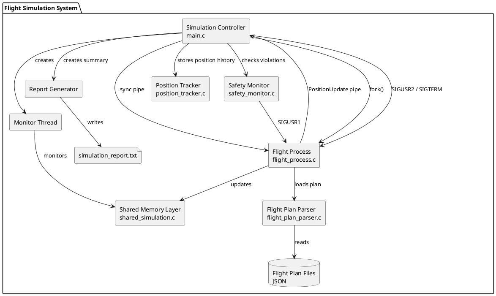

# Flight Simulation System

## Índice

1. Introdução
2. Arquitetura Geral
3. Evolução da Arquitetura entre Sprints
4. US100 - Simulate flights in a given area
5. US102 - Detect safety violations
6. US103 - Synchronize simulation steps
7. US105 - Shared memory coordination
8. US109 - Generate simulation report
9. Estruturas Principais
10. Decisões Técnicas
11. Testes
12. Build e Execução
13. Diagrama de Componentes

---

# 1. Introdução

Este projeto implementa um sistema concorrente de simulação de voos utilizando processos POSIX, pipes, sinais e mecanismos de sincronização.

A solução foi desenvolvida em C e organizada de forma modular para suportar:

- simulação concorrente;
- monitorização de posições;
- sincronização temporal;
- deteção de violações de segurança;
- geração de relatórios.

A arquitetura foi evoluindo incrementalmente ao longo dos sprints, mantendo separação clara entre responsabilidades.

---

# 2. Arquitetura Geral

A solução encontra-se dividida nos seguintes componentes principais:

| Componente             | Responsabilidade                                            |
| ---------------------- | ----------------------------------------------------------- |
| `main.c`               | Coordenação global da simulação                             |
| `flight_process.c`     | Execução individual de cada voo                             |
| `flight_plan_parser.c` | Carregamento e parsing de planos de voo                     |
| `position_tracker.c`   | Histórico temporal das posições                             |
| `safety_monitor.c`     | Validação de segurança                                      |
| `simulation.h`         | Estruturas e contratos partilhados                          |
| `tests/`               | Testes unitários e testes de integração                     |
| `data/`                | Ficheiros de planos de voo usados na simulação e nos testes |

Cada voo executa num processo independente criado através de `fork()`.

A comunicação e sincronização utiliza:

- pipes POSIX;
- sinais POSIX;
- shared memory POSIX;
- semáforos;
- pthread mutexes;
- pthread condition variables;
- sincronização passo-a-passo.

---

# 3. Evolução da Arquitetura entre Sprints

## Sprint 2

O objetivo inicial consistia em criar a base concorrente da simulação:

- criação de processos;
- comunicação por pipes;
- sinais POSIX;
- envio de posições;
- histórico temporal.

## Sprint 3

Durante o Sprint 3 foram introduzidas melhorias importantes:

- sincronização mais segura;
- suporte a múltiplos voos simultâneos;
- suporte a diferentes `DepartureTime`;
- melhor coordenação entre processos;
- melhoria da gestão de recursos;
- sincronização determinística passo-a-passo;
- testes unitários;
- testes de integração.

A arquitetura principal foi mantida, sendo introduzidas melhorias incrementais na robustez da implementação.

---

# 4. US100 - Simulate flights in a given area

## Objetivo

Simular voos concorrentes numa determinada área geográfica utilizando processos independentes.

## Responsabilidades do processo principal

- validar parâmetros;
- criar pipes;
- criar processos filho;
- coordenar os voos;
- iniciar os processos através de `SIGUSR2`;
- monitorizar múltiplos pipes com `poll()`;
- receber `PositionUpdate`;
- atualizar o histórico de posições;
- terminar processos corretamente;
- aguardar processos filho com `waitpid()`;
- gerar o relatório final.

## Responsabilidades dos processos filho

- carregar o plano de voo;
- instalar signal handlers;
- aguardar sincronização com `sigsuspend()`;
- executar segmentos do voo;
- interpolar posições;
- enviar atualizações;
- terminar corretamente;
- reagir a notificações de segurança através de `SIGUSR1`.

## Melhorias introduzidas no Sprint 3

### Substituição de `pause()` por `sigsuspend()`

A sincronização passou a utilizar:

- `sigprocmask()`;
- `sigsuspend()`.

Isto evita race conditions durante o arranque concorrente.

### Bloqueio explícito de sinais antes do `fork()`

O processo pai bloqueia `SIGUSR2` antes da criação dos filhos.

Os filhos herdam essa máscara, instalam os handlers necessários e apenas depois desbloqueiam temporariamente o sinal através de `sigsuspend()`.

### Alteração do sinal de arranque

O arranque da simulação passou a utilizar:

- `SIGUSR2` para arranque;
- `SIGUSR1` para violações de segurança.

### Gestão segura de runtime

Foi criada uma função dedicada para:

- fechar pipes;
- limpar `pollfd`;
- desativar voos;
- evitar fechos duplicados.

### Suporte a `DepartureTime`

Cada voo possui agora o seu próprio `DepartureTime`.

Quando `--start` não é fornecido, o processo principal usa o `DepartureTime` do plano de voo.

Quando `--start` é fornecido, a simulação usa o valor indicado pelo utilizador como início explícito.

---

# 5. US102 - Detect safety violations

## Objetivo

Detetar violações básicas de segurança durante a simulação.

## Responsabilidades

- analisar posições recebidas;
- verificar separação mínima;
- validar altitude mínima;
- registar eventos de segurança;
- notificar processos de voo envolvidos através de sinais;
- permitir terminação antecipada se o número de violações exceder o threshold configurado.

## Integração

O `SafetyMonitor` é executado pelo processo principal após receção dos updates de cada timestep.

Quando é detetada uma violação, o processo de voo envolvido pode ser notificado através de `SIGUSR1`.

---

# 6. US103 - Synchronize simulation steps

## Objetivo

Garantir sincronização temporal entre todos os voos da simulação.

## Modelo de sincronização

A implementação utiliza um modelo híbrido:

| Mecanismo    | Responsabilidade                               |
| ------------ | ---------------------------------------------- |
| sinais POSIX | controlo do ciclo de vida                      |
| pipes        | sincronização passo-a-passo e envio de updates |
| `poll()`     | multiplexagem eficiente                        |

## Funcionamento

### Processo principal

O processo principal:

1. cria os processos;
2. envia o sinal inicial;
3. controla o timestep global;
4. autoriza os filhos a avançar;
5. recolhe updates sincronizados;
6. processa todos os updates esperados antes de avançar.

### Processos filho

Os processos filho:

1. aguardam sincronização;
2. executam apenas o timestep autorizado;
3. enviam posições;
4. aguardam nova autorização.

## Melhorias introduzidas

### Suporte a múltiplos voos concorrentes

A sincronização foi reorganizada para suportar:

- múltiplos pipes;
- múltiplos processos ativos;
- diferentes tempos de partida.

### Integração de `poll()`

O processo principal utiliza `poll()` para monitorizar múltiplos descritores sem busy waiting.

### Separação entre controlo e dados

- sinais para controlo;
- pipes para transmissão de dados e sincronização.

Esta separação melhora clareza e robustez.

---

# 7. US105 - Shared Memory Coordination

## Objetivo

Adicionar coordenação concorrente baseada em memória partilhada.

## Componentes introduzidos

- shared_simulation.c
- SharedSimulationState
- thread de monitorização
- pthread mutexes
- condition variables

## Fluxo

Filhos -> Shared Memory -> Thread do Parent

Os filhos atualizam a memória partilhada.

A thread do parent recebe notificações e monitoriza o estado global.

## Resultado

Permite múltiplos voos concorrentes mantendo compatibilidade com US anteriores.

---

# 8. US109 - Generate simulation report

## Objetivo

Gerar um relatório simples da execução da simulação.

## Informação apresentada

- voos processados;
- posições recebidas;
- eventos de segurança;
- estados finais dos voos;
- resumo da execução;
- resultado final da simulação.

---

# 9. Estruturas Principais

## `SimulationConfig`

Parâmetros globais da simulação:

- área;
- intervalo temporal;
- ficheiros de voo;
- weather;
- thresholds de segurança;
- performance settings;
- indicação se `--start` foi fornecido.

## `FlightPlan`

Representação interna do plano de voo.

## `Segment`

Representa um segmento entre dois pontos.

## `PositionUpdate`

Mensagem enviada pelos filhos:

- posição;
- timestamp;
- altitude;
- velocidade;
- estado;
- identificador do voo.

## `FlightRuntime`

Estado de runtime de cada voo:

- PID;
- pipes;
- estado ativo;
- `DepartureTime`.

## `HistoryEntry`

Entrada do histórico temporal.

## `PositionTracker`

Estrutura global de tracking das posições.

## `SafetyLog`

Estrutura de registo das violações de segurança.

---

# 10. Decisões Técnicas

## Um processo por voo

Permite:

- isolamento;
- concorrência;
- melhor escalabilidade;
- alinhamento com o requisito de criação de um processo por voo.

## Uso de pipes

Os pipes permitem comunicação simples e eficiente entre processos.

São usados para:

- envio de `PositionUpdate`;
- sincronização passo-a-passo.

## Uso de `poll()`

`poll()` evita busy waiting e permite acompanhar múltiplos voos simultaneamente.

## Uso de sinais POSIX

Os sinais são utilizados para:

- sincronização inicial;
- arranque;
- notificação de violações;
- terminação.

## Compatibilidade POSIX

Foi utilizada:

```c
#define _POSIX_C_SOURCE 200809L
```

para garantir compatibilidade com APIs POSIX.

---

# 11. Testes

A pasta `tests/` contém testes unitários e testes de integração.

```text
tests/
├── test_position_tracker.c
├── test_safety_monitor.c
├── run_tests.sh
└── run_integration_tests.sh
```

## 11.1 Testes unitários

### `test_position_tracker.c`

Valida que o `PositionTracker`:

- inicializa corretamente;
- guarda um update;
- mantém a última posição;
- regista o histórico.

### `test_safety_monitor.c`

Valida que o `SafetyMonitor`:

- deteta altitude abaixo do limite mínimo;
- regista a violação no log;
- devolve violações quando aplicável.

### Execução

```bash
chmod +x tests/run_tests.sh
./tests/run_tests.sh
```

Resultado esperado:

```text
Compiling tests...

test_position_tracker OK
test_safety_monitor OK

All tests passed
```

## 11.2 Testes de integração

O script `run_integration_tests.sh` valida o executável completo.

Cenários testados:

1. Simulação com um voo.
2. Simulação com dois voos diferentes.
3. Criação do ficheiro `simulation_report.txt`.
4. Validação de argumentos inválidos.
5. Execução sem deixar processos pendurados.

### Execução

```bash
chmod +x tests/run_integration_tests.sh
./tests/run_integration_tests.sh
```

Resultado esperado:

```text
Building simulator...
Running integration tests...
All integration tests passed
```

## 11.3 Verificações finais realizadas

### Processos pendurados

Foi executado:

```bash
ps -ef | grep flight_simulator
```

Resultado esperado:

```text
grep flight_simulator
```

Isto confirma que não ficaram processos `flight_simulator` pendurados.

### Execução sem `--start`

Foi testado o comportamento em que o sistema usa o `DepartureTime` do ficheiro JSON.

Comando:

```bash
./flight_simulator \
  --area 39 43 -9 -3 \
  --end 3600 \
  --step 60 \
  --flight data/Flight_Plan_v0a.json
```

Resultado validado:

- a simulação começou no segundo `32400`;
- `32400` corresponde a `09:00`;
- foram gerados 61 pontos;
- o relatório final foi criado.

### Compilação com warnings agressivos

Foi executado:

```bash
gcc -Wall -Wextra -Wpedantic -Wshadow -Wconversion \
  -std=c11 -D_DEFAULT_SOURCE \
  src/main.c \
  src/flight_process.c \
  src/flight_plan_parser.c \
  src/position_tracker.c \
  src/safety_monitor.c \
  -o flight_simulator \
  -lm
```

Resultado validado:

- compilação sem erros;
- compilação sem warnings.

---

# 12. Build e Execução

## Compilação

```bash
make
```

## Execução

```bash
./flight_simulator \
  --area 39 43 -9 -3 \
  --start 0 \
  --end 3600 \
  --step 60 \
  --flight data/Flight_Plan_v0a.json
```

## Exemplo com múltiplos voos

```bash
./flight_simulator \
  --area 38 43 -10 3 \
  --start 0 \
  --end 3600 \
  --step 60 \
  --flight data/Flight_Plan_v0a.json \
  --flight data/Flight_Plan_v0c.json
```

## Nota sobre múltiplos ficheiros

Cada ficheiro deve ser precedido de `--flight`.

Correto:

```bash
--flight data/Flight_Plan_v0a.json --flight data/Flight_Plan_v0c.json
```

Incorreto:

```bash
--flight data/Flight_Plan_v0a.json data/Flight_Plan_v0c.json
```

## Execução em AntiX

A execução do projeto foi validada numa máquina AntiX.

### 1. Instalar dependências necessárias

```bash
sudo apt update
sudo apt install default-jdk maven
````

Confirmar instalação:

```bash
java --version
javac --version
mvn -version
```

### 2. Corrigir terminações de linha do script (caso necessário)

Como o `run.sh` foi desenvolvido em ambientes diferentes, pode ser necessário remover terminações Windows:

```bash
sed -i 's/\r$//' run.sh
```

### 3. Compilar o simulador SCOMP

Entrar na pasta do simulador e gerar o executável:

```bash
cd scomp
make
cd ..
```

### 4. Dar permissões de execução

```bash
chmod +x run.sh
chmod +x scomp/flight_simulator
```

### 5. Executar o projeto

A partir da pasta raiz do projeto:

```bash
./run.sh
```

### Notas

* O executável `scomp/flight_simulator` deve existir antes da execução do `run.sh`.
* O simulador SCOMP é implementado em C, mas o projeto completo depende também de Java e Maven devido à componente EAPLI e à execução integrada.
* Todos os testes e validações apresentados na documentação foram executados em ambiente AntiX.

---

# 13. Diagrama de Componentes

O diagrama foi atualizado apenas para incluir o bloco de testes e os ficheiros de dados usados na validação.

A arquitetura principal não mudou devido aos testes.


